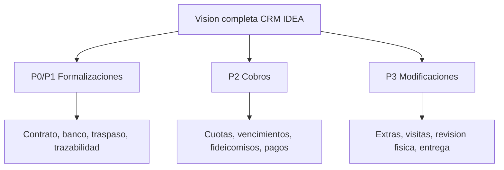

# 00 - Indice de Arquitectura API


Ampliación solicitada el 2026-11-02: [perfil completo del lead](77-Perfil-Completo-Lead.md), lectura federada y permiso global; migración060 preparada, sin aplicación ni despliegue.
## Entrada vigente — 2026-11-02

[72 — Reconciliación completa por commits y código](72-Reconciliacion-Documental-20261102.md)
inventaría los35 commits de HEAD, cambios locales,130 documentos iniciales,
17 dominios API,55 migraciones registradas y herramientas/operación. Incluye
resultados nuevos y fallos actuales; no sustituirlos por QA histórico.

- [22 — Mapa registrado](22-Mapa-de-Implementacion-API.md):31 controladores y119 decoradores HTTP, módulos y límites reales.
- [03 — BD/migraciones/herramientas](03-Base-Datos-y-Migracion.md):55 migraciones más helper, flags057 locales, sin nueva ejecución DDL.
- [39 — Diccionario de órdenes](39-Diccionario-Ordenes-Venta.md): banderas, estado desconocido y evidencia fechada de ambas fuentes.
- [69 — Lectura global de Mercadeo](69-Mercadeo-Lectura-Global.md): permiso adicional sin autorizar CRUD/imports.
- [70 — Sincronización NetSuite](70-Plan-Sincronizacion-Ordenes-NetSuite.md): plan pendiente y traspaso para retomar del 2026-11-02; receptor local solo confirma recepción con persisted:false. Incluye autorización Sandbox → órdenes existentes en legacy y límites de evidencia.
- [Operación](Operacion-Despliegue-Rollback.md) y [Habita](../../../deploy/habita/README.md): procedimientos separados de la evidencia de despliegue del29.

Los cortes inferiores conservan su fecha. Un esquema, una prueba con dobles o
una declaración de ruta no acredita operación real, despliegue o acceso externo.

Mercadeo: [69 - Lectura global](69-Mercadeo-Lectura-Global.md) distingue el permiso
de consulta global de los alcances personales y de los permisos de edición.

Calendario: [68 - Participantes y vínculos](68-Calendario-Participantes-y-Vinculos.md) documenta el formulario ampliado, búsquedas autorizadas en ambas fuentes, migración055 y persistencia auditada sin correo/Graph.

Implementación y verificación local: [68 - Notas vinculadas a clientes/leads y órdenes](68-Plan-Notas-Vinculos-Clientes-y-Ordenes.md)
documenta búsqueda nativa/legacy, relaciones múltiples, permisos y presentación.
Reutiliza el esquema de vínculos existente, sin importar registros comerciales.

QA de regresiones: [67 - Plan y resultados del 29 de octubre](67-Plan-QA-Regresiones-20261029.md)
separa pruebas desactualizadas, resultados ejecutados y aceptacion Redis pendiente.

Notas: [66 - Seguimiento colaborativo](66-Notas-Enterprise-Seguimiento.md) documenta responsables,
vencimientos, recordatorios personales, ubicaciones e historial con migraciones052/053.

Formalización: [65 - Roles y recuperación](65-Formalizacion-Correcciones-Roles-y-Recuperacion.md)
registra la autorización de gestión de todas las órdenes con permiso para ambos
roles, la migración049 y las correcciones de recuperación posteriores a la auditoría.

Formalización, regla de detalle vigente 2026-10-28:
[64 - Ver orden de venta](64-Formalizacion-Permiso-Ver-Orden.md) separa el
permiso de ficha de los permisos de banners/listas. No amplía escrituras.

Etapa1 de notas autorizada/aplicada2026-10-27:039 crea siete tablas vacias en
CRM_THINK_V2;91 columnas comentadas,24 FK,15 CHECK. Sin imports, permisos,
API/UI, notificaciones o escritura legacy. Fechas de modificacion explicitas
UTC y autoria/ACL pendientes de los comandos de etapa2. Ver [56](56-Plan-Notas-Colaborativas-y-Convivencia-Legacy.md)
y [diccionario](Diccionario-Datos/12-Notas-Colaborativas.md).


Plan en ejecucion, etapa1 aplicada: [56 - Notas colaborativas y convivencia legacy](56-Plan-Notas-Colaborativas-y-Convivencia-Legacy.md), investigacion SELECT del27; decision confirmada: BD nueva principal y copia compatible legacy, solo esquema nativo implementado por ahora.


## Revision integral vigente - 2026-10-27

[55 - Revision documental integral](55-Revision-Documental-Integral-20261027.md):
inventario, matriz de cobertura, correcciones y validaciones de este checkout.
[49](49-Estado-Actual-y-Cierre-Documental.md) conserva los snapshots y la cronologia.
[52](52-Etapas-Responsables-y-Tiempos.md) describe transiciones y tiempos registrados;
[53](53-Captacion-Leads-Reporte-Federado.md) el reporte conectado y retiro del menu
Eventos y citas por038. Las entradas fechadas23/26 conservan su corte historico.


Captacion de leads conectada (2026-10-26): consulta nativa primero y legacy opcional,
sin importaciones, con permiso propio y un JSON agregado. Ver [53 - Reporte](53-Captacion-Leads-Reporte-Federado.md).

## Lectura vigente - 2026-10-23

[49 - Estado actual y cierre documental](49-Estado-Actual-y-Cierre-Documental.md):
plan, matriz extremo a extremo, evidencia de solo lectura, precedencia documental,
revision de 97 Markdown, plan aplicado, trazabilidad de punta a punta y pendientes
reales. Usar antes de interpretar cortes antiguos.

Ultimas ampliaciones: [43 - Leads](43-Leads-Esquema-Nativo.md),
[44 - Timeline](44-Bitacora-Legacy-y-Timeline.md),
[45 - Usuarios/Ventas](45-Usuarios-Por-Correo.md),
[46 - Mercadeo](46-Mercadeo-Resumen-Leads.md),
[47 - Esquema calendario](47-Calendario-Compartido-Esquema.md),
[48 - Metricas de citas](48-Mercadeo-Metricas-Citas.md).

[47 - Calendario compartido](47-Calendario-Compartido-Esquema.md): esquema nativo
034 autorizado, sin datos ni runtime, con origen por modulo, participantes,
campana individual y referencias externas. Prevalece sobre ejemplos antiguos de 17.

[45 - Usuarios por correo](45-Usuarios-Por-Correo.md): excepcion limitada
autorizada para crear perfiles sin accesos y sin modificar legacy.

## Historia de Leads sin importacion - 2026-10-23

[44 - Bitacora](44-Bitacora-Legacy-y-Timeline.md): correccion del alcance,
eliminacion de la copia historica y consulta por origen para un JSON comun.
Sin importaciones ni escrituras legacy. La integracion HTTP federada sigue pendiente.

## Esquema nativo de Leads - 2026-10-23

[43 - Leads](43-Leads-Esquema-Nativo.md): migracion 031 nativa autorizada,
responsable por `sec_user`, referencias externas por sistema e ID, etapas y
motivos con historial repetible. Sin importacion de leads ni runtime comercial.

## Jefaturas por modulos - 2026-10-23

[42 - Jefaturas](42-Jefaturas-Modulos-y-Permisos.md): politica persistida de
Jefe General limitada a modulos operativos seleccionados, techos de roles de
area y denies individuales. Migracion nativa 029 aplicada; evidencia y limites
en 42. Owner conserva la politica global de 41, sin asignaciones masivas.

## Owner efectivo y denegaciones - 2026-10-23

[41 - Owner](41-Owner-Herencia-y-Denegaciones.md): migracion 027 aplicada en
CRM_THINK_V2. Owner hereda roles activos; un deny individual prevalece. Banners
de etapas requieren rol efectivo Formalizacion y, desde la regla del 2026-10-28,
el permiso específico de cada banner: [63 - Lectura por banner](63-Formalizacion-Lectura-Por-Banner.md).
Esta regla prevalece sobre las descripciones historicas de rol exclusivamente directo.

## Resumen de etapas de Home - 2026-10-23

[40 - Plan, contrato y rendimiento](40-Formalizacion-Home-Resumen-y-Rendimiento.md):
conectar los seis banners de etapas con un agregado por rol activo Formalizacion;
aprobaciones mantiene su permiso independiente. Esta ampliacion es de lectura,
sin listado ni cambios de estado. La evidencia de ejecucion y las definiciones
pendientes se registran en 40; no convertir pruebas sinteticas en prueba MySQL.
Las descripciones fechadas de cinco ceros provisionales corresponden al corte
anterior, no al objetivo de esta ampliacion.

## Consolidacion historica - 2026-10-22, sustituida por el corte vigente

Remediacion posterior: [plan central F01-F13 del 2026-10-23](Reauditoria-54-Plan-y-Resultados.md#plan-central-f01-f13---2026-10-23), con resultados fechados en ese documento. [Runbook de auditoria central](Operacion-Despliegue-Rollback.md#auditoria-central-activacion-y-apagado): default false, preflight 023/024, activacion/apagado y limites. El corte del 22 tenia dos banners reales y cinco provisionales; el resumen del 23, documentado en 40/49, sustituye ese estado. Bandejas vacias y list/send/revert no registrados prevalecen sobre descripciones historicas posteriores en este indice.

Precedencia final: [38 - Solo Home](38-Ordenes-Venta-Estados-Auditoria.md#alcance-final-corregido-solo-home---2026-10-22). Bandeja real y acciones retiradas por el propietario; solo resumen contractual registrado. Lectura/listado y comandos preparados no expuestos.

Ultimo corte: [38 - Contratos por fuente](38-Ordenes-Venta-Estados-Auditoria.md#contratos-resumen-y-transiciones-por-fuente---2026-10-22). Banner real por rol, etapas aditivas legacy aplicadas y comandos HTTP protegidos; autoridad nativa si existe, legacy si no, evidencia central nativa. Lista/botones operativos y prueba comercial real posteriores.

Estado posterior: [38 - Activacion local y 024 aplicada](38-Ordenes-Venta-Estados-Auditoria.md#activacion-local-y-migracion-024-aplicada---2026-10-22). Bitacora activa en .env local, API reiniciado y health aprobado. Cuenta compartida conserva privilegios amplios; inmutabilidad SQL no certificada. Conexion legacy READ ONLY; escritura productiva y prueba de cambio de estado siguen pendientes.

Avance posterior: [38 - Escritores conectados y activacion pendiente](38-Ordenes-Venta-Estados-Auditoria.md#escritores-conectados-activacion-pendiente---2026-10-22). Codigo y unidades sin escrituras de validacion en BD; logging central desactivado por defecto hasta preparar 024/privilegios. Politica de lectura audit compartida entre guard y servicio.

Bitacora comercial central: migracion nativa 023 y diccionario en [38 - Bitacora central](38-Ordenes-Venta-Estados-Auditoria.md#bitacora-central-de-registros---2026-10-22). Estructura aplicada, sin captura automatica de todos los escritores ni restauracion ejecutable; Contratos sigue pendiente de conexion.

Entradas actuales: [resumen API](01-Resumen-API.md), [mapa vigente y blueprint](22-Mapa-de-Implementacion-API.md), [remediacion/evidencia](Reauditoria-54-Plan-y-Resultados.md), [plan correctivo](Plan-Correctivo-Auditoria-CRM-TINK.md), [CI/MySQL](CI-MySQL-Pruebas.md) y [operacion/rollback](Operacion-Despliegue-Rollback.md). Distinguir codigo implementado, evidencia historica y validacion productiva pendiente.

Ampliaciones de Administracion: [35 - Catalogos](35-Catalog-API-and-Schema.md), [36 - Registro e inventario documental](36-Registro-Entrega-Administracion.md), [37 - Auditoria](37-Auditoria-Trazabilidad-y-Conflictos.md), [38 - Ordenes/estados/auditoria](38-Ordenes-Venta-Estados-Auditoria.md) y [39 - Diccionario de ordenes](39-Diccionario-Ordenes-Venta.md). El contador de aprobaciones es real; el ciclo de vida HTTP completo no esta implementado. Los blueprints de Leads y otras verticales siguen siendo futuros.

### Base de continuidad - 2026-10-13

Leer [36 - Registro integral de entrega](36-Registro-Entrega-Administracion.md) para solicitudes, decisiones, codigo, pruebas y pendientes; [37 - Auditoria y conflictos](37-Auditoria-Trazabilidad-y-Conflictos.md) para snapshots, trazabilidad y manejo de 409; y [27 - Entrega visual y QA](../../frontend/Arquitectura/27-Entrega-Administracion-y-QA.md) para comportamiento de pantallas. Complementan documento 35 y sustituyen descripciones historicas obsoletas sin borrar evidencia previa.

## Implementation Update - 2026-10-09

Read [catalog API/schema](35-Catalog-API-and-Schema.md), [migration runbook](03-Base-Datos-y-Migracion.md), [release notes](../../../CHANGELOG.md) and [closure evidence](34-Cierre-Operativo-Administracion-P0-S1.md) for current Administration behavior. Complete ETL and Owner acceptance remain separate pending gates.

## Entrada de continuidad 2026-10-08

Comenzar con [README raiz](../../../README.md), ley de producto y [34 - Traspaso y cierre](34-Cierre-Operativo-Administracion-P0-S1.md). Para frontend: [25 - Continuidad](../../frontend/Arquitectura/25-Continuidad-Administracion.md).

El documento 34 consolida estado inspeccionado, contratos HTTP reales, decisiones scoped, migraciones, hallazgos y backlog. Los mapas 08/21/22 quedan como antecedentes de planificacion cuando describen pausas o carpetas futuras; no son inventario runtime. Documentos comerciales 10-20 y 23/25 conservan analisis y vision, no acreditan implementacion ni autorizan avanzar antes del cierre.

Los SQL/seed iniciales son baselines historicos; cambios posteriores viven en migrations/schema-only y deben contrastarse con historial real antes de ejecutar. No usar conteos seed iniciales como total vigente.


## Proposito

Este indice permite navegar la documentacion tecnica del API del CRM.

La documentacion debe servir para ingenieros, analistas y usuarios de negocio. Cada documento debe explicar el objetivo en lenguaje claro y luego bajar al detalle tecnico cuando aplique.

## Lectura cero

Antes de leer cualquier otro documento, abrir:

```txt
00-Producto-CRM-TINK-y-P0.md
```

Si `00-Producto-CRM-TINK-y-P0.md` contradice a este indice, `AGENTS.md`, un modelo de datos, una skill o cualquier documento futuro, gana `00-Producto-CRM-TINK-y-P0.md` hasta que el dueno del producto apruebe una nueva version.

Regla documental: no crear documentos nuevos para resolver dudas de alcance sin retirar, fusionar o degradar otro documento. La ley `00-Producto-CRM-TINK-y-P0.md` manda.

## Regla de uso

Antes de crear codigo, tablas, migraciones, endpoints o integraciones, leer primero `00-Producto-CRM-TINK-y-P0.md`, despues este indice y luego los documentos relacionados.

## Lectura obligatoria P0-S1A por orden

0. `00-Producto-CRM-TINK-y-P0.md`
1. `27-Identidad-Usuarios-Roles-P0-S1.md`
2. `28-Matriz-Roles-Permisos-Areas-P0-S1.md`
3. `31-Contrato-Identidad-y-Permisos-P0-S1.md`
4. `33-Contrato-API-Identidad-P0-S1.md`

Si hay pelea entre estos documentos, gana `00-Producto-CRM-TINK-y-P0.md`.

## Consulta tecnica P0-S1A

Estos documentos se consultan solo cuando se revise MySQL, seguridad o bootstrap. No agregan alcance nuevo:

1. `24-Seguridad-Autenticacion-BFF-OIDC-Local.md`
2. `29-Modelo-Fisico-MySQL-Identidad-P0-S1.md`
3. `30-Identidad-Canonica-y-Referencias-Externas.md`
4. `32-Seeds-Identidad-P0-S1.md`
5. `34-Cierre-Operativo-Administracion-P0-S1.md`
6. `Diccionario-Datos/01-Identidad-y-Permisos.md`
7. `SQL/001_identity_schema_p0_s1.sql`
8. `SQL/002_identity_seed_p0_s1.sql`
9. `SQL/003_identity_login_readiness_p0_s1.sql`
10. `21-P0-Direccion-Tecnica-Construccion-Pausada.md`
11. `22-Mapa-de-Implementacion-API.md`

## Lectura futura, fuera de P0-S1

Estos documentos existen para conservar vision, no para autorizar implementacion en P0-S1:

1. `16-Alcance-PDFs-y-Modularizacion-Dominios.md`
2. `17-Calendarios-por-Dominio-y-Supervision.md`
3. `18-Notas-Adhesivas-y-Anotaciones.md`
4. `23-Alcance-P0-Vertical-Leads.md`

Solo se leen cuando `00-Producto-CRM-TINK-y-P0.md` o una decision aprobada por el dueno del producto habilite ese alcance.

## Documentos

| Archivo | Para que sirve |
| --- | --- |
| `00-Producto-CRM-TINK-y-P0.md` | Ley superior de producto: que somos, que no somos, P0-S1 y prohibiciones actuales. |
| `01-Resumen-API.md` | Resume la decision tecnica principal del backend. |
| `02-Arquitectura-Backend.md` | Explica estructura NestJS, capas, modulos e integraciones. |
| `03-Base-Datos-y-Migracion.md` | Define MySQL, Kysely, migracion legacy y reglas de datos. |
| `04-Integraciones-ERP.md` | Explica como aislar ERP, Kapso, Microsoft 365, legacy CRM y otras integraciones externas por adapters. |
| `05-Seguridad-Auditoria-Observabilidad.md` | Define autenticacion, permisos, auditoria y trazabilidad. |
| `06-ADRs-API.md` | Guarda decisiones arquitectonicas aprobadas. |
| `07-Skills-Codex-Instaladas.md` | Lista skills locales y su uso esperado. |
| `08-Revision-Blueprint-y-Siguiente-Paso.md` | Resume revision del blueprint, pausa de runtime y prioridades antes de implementar. |
| `09-Decisiones-P0-Permisos-y-Preguntas.md` | Guarda decisiones P0 y preguntas abiertas/cerradas. |
| `10-Analisis-CRM-Actual-Roles-Leads.md` | Evidencia del CRM actual revisada en base/codigo. |
| `11-Contrato-Canonico-y-Normalizacion.md` | Regla de JSON canonico y nombres neutrales. |
| `12-Modelo-Datos-P0-MySQL-Kysely.md` | Modelo inicial normalizado de base de datos. |
| `13-Bitacora-Acciones-y-Timeline-Lead.md` | Reglas de bitacora, timeline, motivos y auditoria del lead. |
| `14-Diccionario-de-Datos-y-Modulos.md` | Diccionario inicial de tablas, modulos y acciones. |
| `15-Flujo-Comercial-Lead-a-Contrato.md` | Flujo oficial Lead -> Oportunidad -> Estimacion -> Orden de Venta -> Contrato. |
| `16-Alcance-PDFs-y-Modularizacion-Dominios.md` | Analiza los PDFs base y define separacion por dominios: ventas, formalizaciones, cobros, modificaciones y jefatura. |
| `17-Calendarios-por-Dominio-y-Supervision.md` | Define calendarios separados por dominio y vista consolidada de jefatura por permisos. |
| `18-Notas-Adhesivas-y-Anotaciones.md` | Define notas adhesivas/anotaciones como modulo transversal con permisos, auditoria, entidades relacionadas e integraciones. |
| `19-Reglas-Operativas-Leads-SLA-y-Perdida.md` | Define leads nuevos, requiere atencion, pausa/reactivacion, perdida, SLA y explicacion gerencial de indicadores. |
| `20-Pendientes-Decisiones-y-Preguntas-P0.md` | Lista decisiones cerradas, preguntas abiertas y pendientes criticos antes de codificar P0. |
| `21-P0-Direccion-Tecnica-Construccion-Pausada.md` | Documento corto de referencia P0 tecnica; el runtime minimo de identidad ya esta autorizado por la ley vigente, mientras modulos comerciales siguen prohibidos. |
| `22-Mapa-de-Implementacion-API.md` | Mapa practico de carpetas futuras, responsabilidades, dependencias permitidas y primer vertical slice del API. |
| `23-Alcance-P0-Vertical-Leads.md` | Alcance comercial futuro de leads: crear/listar/detalle con timeline y auditoria despues de cerrar identidad. |
| `24-Seguridad-Autenticacion-BFF-OIDC-Local.md` | Regla obligatoria y explicacion operativa de autenticacion BFF, cookies opacas, refresh rotation, Microsoft OIDC, login local, CORS, CSRF, headers, validacion y errores. |
| `25-Contrato-Canonico-Minimo-Lead-P0-S1.md` | Contrato minimo vivo de lead/contacto antes de convertirlo en modelo MySQL o DTOs. |
| `26-Estandar-Nombres-Base-Datos.md` | Regla oficial para nombres de base: prefijos por dominio, columnas con sufijo de entidad y cero nombres de proveedores externos. |
| `27-Identidad-Usuarios-Roles-P0-S1.md` | Primera compuerta P0-S1: usuarios, autenticacion, roles, permisos minimos y auditoria de acceso antes de modelar leads. |
| `28-Matriz-Roles-Permisos-Areas-P0-S1.md` | Matriz operable de roles, permisos, areas, alcances y overrides personales para que jefatura gestione acceso sin crear roles infinitos. |
| `29-Modelo-Fisico-MySQL-Identidad-P0-S1.md` | Modelo fisico MySQL de identidad: usuarios, login, roles, permisos, areas, ids externos y auditoria de seguridad. |
| `30-Identidad-Canonica-y-Referencias-Externas.md` | Regla transversal: relaciones internas por IDs propios del CRM y proveedores externos solo como referencias `int_`. |
| `31-Contrato-Identidad-y-Permisos-P0-S1.md` | Contrato aprobado de identidad P0-S1A: roles, areas, permisos efectivos, overrides directos, denegaciones y revocacion. Delegacion temporal queda fuera. |
| `32-Seeds-Identidad-P0-S1.md` | Datos iniciales aprobables para roles, permisos, areas, sistemas externos y usuario owner. Los seeds no se ejecutan en la validacion schema-only. |
| `33-Contrato-API-Identidad-P0-S1.md` | Contrato conceptual y flujo operativo de sesion, usuario actual, login local, refresh, logout, roles, areas y permisos efectivos. No es OpenAPI ejecutable. |
| `34-Cierre-Operativo-Administracion-P0-S1.md` | Guia de cierre operativo para validar usuarios, roles, catalogos, auditoria, permisos scoped, pruebas automaticas y validacion manual antes de construir mas pantallas. |
| `Diccionario-Datos/01-Identidad-y-Permisos.md` | Diccionario de datos de identidad y permisos en lenguaje claro para ingenieria y negocio. |
| `SQL/001_identity_schema_p0_s1.sql` | Artefacto SQL controlado del esquema MySQL P0-S1 de identidad para instalacion limpia. El baseline vigente ya incluye estructuras de login seguro; una base existente anterior debe evolucionar con `SQL/003`. |
| `SQL/002_identity_seed_p0_s1.sql` | Artefacto SQL controlado de seeds P0-S1 de identidad. Los catalogos no crean usuarios; el primer owner Roberto fue autorizado por la ley `0.3.21` y su crosswalk externo fue precisado por la ley `0.3.22`. |
| `SQL/003_identity_login_readiness_p0_s1.sql` | Artefacto SQL aplicado por el runner idempotente `202609250003_identity_login_readiness` para evolucionar la base `CRM_THINK_V2` creada antes del login seguro. Futuras migraciones siguen requiriendo autorizacion escrita. |

## Documentacion futura por carpeta

Cuando el proyecto avance, crear carpetas internas:

```txt
Diccionario-Datos/
Acciones/
Flujos/
Diagramas/
```

Regla: cada modulo grande debe tener su propio archivo. No mezclar leads, oportunidades, estimaciones, ordenes de venta y contratos en un unico documento gigante.

## Mapa rapido de implementacion

Antes de crear o modificar codigo del API, abrir:

```txt
00-Producto-CRM-TINK-y-P0.md
27-Identidad-Usuarios-Roles-P0-S1.md
28-Matriz-Roles-Permisos-Areas-P0-S1.md
31-Contrato-Identidad-y-Permisos-P0-S1.md
33-Contrato-API-Identidad-P0-S1.md
34-Cierre-Operativo-Administracion-P0-S1.md
```

Esa lectura define:

- que se permite en identidad P0-S1A;
- que queda fuera;
- que contrato API conceptual debe respetarse;
- por que solo el runtime minimo de identidad esta autorizado y el runtime comercial sigue prohibido.

Antes de pasar a cualquier contrato comercial, cerrar `34-Cierre-Operativo-Administracion-P0-S1.md` con evidencia.

El siguiente slice aprobado en papel es identidad/Administracion P0-S1A. El documento `23-Alcance-P0-Vertical-Leads.md` se consulta despues de aprobar avanzar mas alla de Administracion. Para Leads, el primer paso posterior sera contrato NetSuite -> API, no pantalla.

## Flujo comercial oficial


Resumen para negocio:

Todo nace desde un lead. Si el cliente avanza, el lead pasa por oportunidad, luego estimacion, luego orden de venta y finalmente contrato firmado.

Resumen tecnico:

El API debe conservar historico y timeline de cada avance. Ningun estado o accion debe sobrescribir informacion sin dejar bitacora.

## Alcance por fases




## Authorized Marketing Home read extension - 2026-10-23

The owner authorized real lead aggregates for Marketing Home through
`GET /marketing/home/summary?period=day|week|month|year`. Read native leads first,
then the optional legacy adapter, and produce one JSON without copying records.
Count all leads created in the interval regardless of current status. Preserve
permission scopes, canonical seller/project identities and local public-ID photos.
Appointment metrics are now authorized as read-only calendar queries: native events first, then legacy Cita events, attributed through the lead owner/project. No imports or calendar mutations. See `apps/api/Arquitectura/48-Mercadeo-Metricas-Citas.md` (repository-relative).
This scoped authorization supersedes historical mock-only restrictions for this
summary only; it authorizes no imports, business mutations, migrations or deployment.
API contract and verification: `apps/api/Arquitectura/46-Mercadeo-Resumen-Leads.md`
(relative to the repository root).

## Actualizacion operativa - 2026-10-26

[52 - Etapas, responsables y tiempos](52-Etapas-Responsables-y-Tiempos.md):
estructura aplicada a ambas bases, consulta paginada y limites operativos.


Lectura autorizada 2026-10-27: [56 - Bitácora de orden y expediente](56-Orden-Bitacora-y-Expediente-Lectura.md), paneles laterales, fuentes auditadas y límites de evidencia.

- [57 - Notas: API protegida, etapa2](57-Notas-Etapa2-API.md): permisos por modulo, autoria, versionado, idempotencia y outbox inerte. UI/campanita/copia pendientes.

- [58 - Notas personales: interfaz etapa3](58-Notas-Etapa3-Interfaz-Personal.md): icono junto a campana, panel lateral, movimiento/tamano/PIN y guardado.

- [59 - Notas desde cualquier vista y relacion opcional](59-Notas-Contexto-Opcional-y-Vistas.md): checkbox, personal, vistas registradas y ordenes legacy sin importacion.

- [60 - Notas etapa4: colaboración y notificaciones](60-Notas-Etapa4-Colaboracion-y-Notificaciones.md): participantes, conversación, API protegida, esquema044 y campana interna; copia legacy pendiente.
- [61 - Plan de notas y avisos en tiempo real](61-Plan-Notas-Tiempo-Real.md): plan ejecutado; implementación, autorización entre módulos y evidencia vigentes en documento62.

Actualización vigente 2026-10-28: [62 - Notas en tiempo real](62-Notas-Tiempo-Real-Implementacion.md). Socket.IO, migración046 aditiva aplicada, campana/hilo/bandejas, recuperación REST y acceso a notas independiente del registro vinculado. Esta actualización sustituye las limitaciones históricas de transporte y acceso de las etapas anteriores. Copia legacy inactiva; Redis multiinstancia y aceptación visual real pendientes.

- [63 - Aprobacion de Formalizacion confirmada en NetSuite](63-Aprobacion-Formalizacion-NetSuite.md): contrato de aprobacion, autoridad nativa/legacy, auditoria, reintentos y limites de verificacion.

- [64 - Calendario global por módulo](64-Calendario-Global-API-y-Contexto.md): vista compartida, superposición autorizada, comandos nativos auditados y contexto legacy aditivo; Outlook e invitados pendientes.
