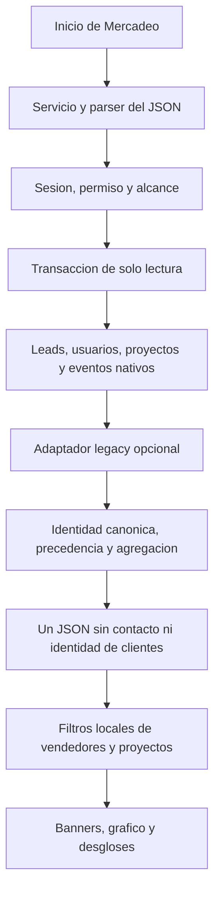

# 49 - Estado actual y cierre documental de CRM TINK

## Corte vigente contrastado — 2026-11-03

Revisión documental del árbol de trabajo de `temp/crm-tink-api-frontend-inicial`,
con base en HEAD `4d446ed`. Incluye cambios locales; no acredita publicación.

- NetSuite v2 dispone de escritor transaccional nativo primero y legacy solo en
  ausencia de autoridad nativa, recibos/cursor, snapshot y auditoría. v1 mantiene
  `persisted:false`. La ampliación de campos está en [75](75-Matriz-Campos-Ordenes-NetSuite.md)
  y la evidencia real acotada de diez indicadores en [73](73-Sincronizacion-Estados-Ordenes-NetSuite.md).
- Contratos usa aprobación de Formalización; la acción que otorga esa aprobación
  conserva sus prerrequisitos independientes. Origen de fondos, ocho etapas y
  combinaciones confirmadas de cierre están en [78](78-Formalizacion-Origen-Fondos-y-Gestion-Bancaria.md).
  Eventos NetSuite `edit`/`xedit` pueden avanzar visitas finales existentes según
  esos indicadores; no hay retroceso automático ni etapas inventadas al consultar.
- Microsoft 365 tiene adaptador y endpoints conectados para agenda propia,
  disponibilidad, salas, invitaciones y Teams, condicionados a sesión Microsoft,
  permisos CRM y consentimiento: [64](64-Calendario-Global-API-y-Contexto.md).
  Implementación no equivale a aceptación externa con cuenta real.
- El adéndum es un marcador independiente de la etapa, con versión y nota manual;
  calendario conserva orden/cliente fijos y bloquea otro adéndum futuro.
  Contratos funcionales/esquema: [83](83-Adendum-Migracion-065-y-Rollback.md) y
  [84](84-Adendum-Manual-Migracion-066-y-Permisos.md), incluida la corrección067.

Los cortes inferiores conservan cronología y resultados de su fecha. Este corte
prevalece para inventario actual; no autoriza migraciones, escrituras, cambios de
credenciales, publicación ni despliegue. No se vuelven a ejecutar suites por editar documentación.

## Corte vigente — 2026-11-02

La revisión transversal actual es[72](72-Reconciliacion-Documental-20261102.md):
35 commits alcanzables hasta `fcbf0c2`, cambios locales separados, inventario
completo de áreas/documentos y resultados nuevos. Este corte prevalece sobre
los resúmenes del29 y anteriores conservados más abajo.

Se corrigieron las descripciones de notas relacionadas, calendario ampliado,
fichas y capítulos NetSuite de Formalización, Mercadeo global, logging/receptor
local, migraciones y herramientas. Los mapas[22](22-Mapa-de-Implementacion-API.md)
y[30 frontend](../../frontend/Arquitectura/30-Estado-Frontend-Verificado.md)
contienen la cobertura por controladores/rutas/consumidores, no solo un resumen.

No confundir el receptor local `persisted:false` con sincronización duradera
implementada: esta continúa en plan70. Los siete flags057 están en el árbol
local, con evidencia DDL histórica en39; no se reconsultó ni modificó MySQL hoy.
La [publicación Habita del29](../../../deploy/habita/DEPLOYMENT-20261029.md)
es evidencia fechada y no confirma el release activo ni publicación de HEAD.

QA nuevo: el comando raíz falla por formato SuiteScript; la suite API separada
registra6961 aprobadas/1 fallida/161 omitidas, y la frontend1270/1fallida. Frontend
lint tiene4 fallos. Tipos y builds se verifican aparte y se registran en72; no
se editó código para ocultar errores ni se promocionó QA antiguo como actual.
No hubo DB writes, imports, credenciales, despliegue ni pruebas reales de ERP,
Graph, Redis multinodo o cuentas de empleados durante esta revisión documental.

## Corte vigente de notas y QA - 2026-10-29

La implementación de notas comprende API/UI personal, compartir con usuarios de
otros módulos, respuestas y menciones, campana, publicación Socket.IO duradera,
seguimiento/silencio, posiciones/PIN/tamaño personales y acciones de metadatos
en segundo plano. Crear/editar contenido conserva confirmación de guardado.
Se pueden invitar cuentas activas, inactivas y pendientes sin activarlas; la
lectura/entrega vuelve a comprobar la autorización y revocación.

La nota usa identidad canónica de registro, no URL ni referencia ERP. Un invitado
sin permiso de orden conserva la nota en campana/Mis notas, con `context: null`.
La ficha/autorizador operativo disponible sigue siendo Formalización; no se
inventan fichas de otros módulos. Las migraciones052/053 y [66](66-Notas-Enterprise-Seguimiento.md)
añaden ubicaciones Home, responsable, vencimiento, recordatorios privados,
filtros/búsqueda e historial con cola durable. Copia legacy, adjuntos y correo
externo permanecen fuera de esta entrega; no se importaron notas antiguas.

QA ejecutado el29 y consolidado en [67](67-Plan-QA-Regresiones-20261029.md):
API6524 aprobadas/151 omitidas, frontend1233 aprobadas y32 SQL/socket aprobadas
en esquemas temporales eliminados. Se corrigieron expectativas/fixtures obsoletas
del inventario HTTP y navegación; no se relajaron permisos de producción.
El primer check raíz terminó con error de tipado en pruebas; tras corregirlo el
check frontend completo aprobó. No presentar aquel log raíz como exit0.
Redis entre procesos, benchmark de latencia/carga y aceptación visual con dos
cuentas reales siguen sin verificarse. Este cierre documental no ejecuta pruebas,
consultas, migraciones, comandos comerciales ni despliegue. Los cortes anteriores
conservan su fecha y no describen por sí solos el estado actual.

Notas etapas1–4 implementadas2026-10-27: esquema nativo, API, interfaz, participantes, conversación y campana interna. [Contrato60](60-Notas-Etapa4-Colaboracion-y-Notificaciones.md) distingue evidencia y límites. Sin imports ni escritura legacy. [Plan56](56-Plan-Notas-Colaborativas-y-Convivencia-Legacy.md) y [diccionario](Diccionario-Datos/12-Notas-Colaborativas.md).

## Corte vigente de revision integral - 2026-10-27

[55 - Revision documental integral](55-Revision-Documental-Integral-20261027.md)
reconcilia el checkout actual, el inventario de documentacion y las limitaciones.
Prevalece sobre afirmaciones historicas de solo maqueta, comandos no registrados,
seguimiento vacio o cifras de BD presentadas sin fecha. Conserva las autorizaciones
acotadas de cada dominio; no convierte planes en funciones implementadas.

- Captacion real: API federada nativa primero, legacy opcional, un JSON sin copia;
  frontend actual con periodos, filtros/desgloses y exportacion documentados en53
  y en el mapa frontend. Inicio mantiene su contrato independiente.
- Eventos y citas: menu retirado y permiso eliminado por038, con invalidacion de
  versiones de acceso. No elimina Calendario ni las metricas de citas.
- Formalizacion: ContractTransitionModule y NetsuiteModule registrados;
  seguimiento, tiempos y comandos dejan de ser exclusivamente codigo preparado.
  Los permisos y gates siguen siendo obligatorios. Ver52 y22.
- No se realiza SELECT nuevo ni modificacion de datos en este cierre. No tomar
  tablas vacias, conteos, flags o ledger de23/26 como snapshot del27.

Ambos typechecks pasaron el27. La comprobacion oficial `check-all.cmd` se detuvo
por formato en tres archivos de API antes de los pasos siguientes; ver55.
Las cifras de pruebas posteriores conservan su fecha y no se reejecutan por editar Markdown.

## Captacion de leads conectada - 2026-10-26

El propietario autoriza pasar la vista de maqueta al reporte de solo lectura
`GET /marketing/leads/report`. Lee CRM_THINK_V2 antes del adaptador legacy y
entrega agregados de leads/citas/perdidos por vendedor/proyecto/campana/anuncio.
Sin copiar registros a la nueva BD, migraciones, permisos nuevos ni escritores.
La consulta nativa vacia es valida; el fallback no se transforma en demo ni ceros
si falla. [53 - Contrato y entrega](53-Captacion-Leads-Reporte-Federado.md)
registra predicados, conciliacion SQL y limites de evidencia. Las entradas
anteriores de Captacion solo UX describen versiones historicas.

## Etapas y tiempos en ambas fuentes - 2026-10-26

[52 - Etapas, responsables y tiempos](52-Etapas-Responsables-y-Tiempos.md)
actualiza el corte: migracion 036 nativa y ampliacion legacy aplicadas;
consulta de trayectoria disponible y ContractTransitionModule registrado.
Por autorizacion posterior, escrituras legacy habilitadas en la configuracion
local del API; los escritores de catalogos conservan su gate de produccion.
No se movieron
ordenes reales. Los apartados fechados 2026-10-23 conservan caracter historico.

## Actualizacion de presentacion - 2026-10-26

Inicio de Mercadeo usa textos aclarados: Leads registrados, Leads registrados
que tienen cita y Citas marcadas como completadas. Fechas de comparacion y
ventana reciente explicitas; diferencia absoluta y conteos en avisos, priorizados
por cantidad de leads que disminuyeron. No cambia calculos, permisos ni consultas.
Captacion de leads en `/home/marketing/leads` pasa de H1 a maqueta UX de
filtros y comparaciones con datos ficticios locales, protegida por el permiso
existente `mercadeo.leads.read`; no agrega consultas API/BD ni CRUD.
Detalle en [QA frontend](../../frontend/Arquitectura/27-Entrega-Administracion-y-QA.md)
y [48](48-Mercadeo-Metricas-Citas.md). El inventario y los snapshots del cierre
siguiente conservan fecha 2026-10-23; no se presentan como una nueva consulta de BD.

## Cambio de datos posterior - 2026-10-26

[51 - Limpieza nativa](51-Limpieza-Datos-Nativos.md) registra el vaciado
autorizado de 53 tablas, sin respaldo, conservando los 46 usuarios y sus accesos.
Los snapshots nativos siguientes son anteriores a esa limpieza. Se conservaron
estructura y ledger; legacy no se modifico. El trabajo de seguimiento de50 quedo interrumpido en ese momento;
la conexion posterior y sus limites se documentan en50/52 y el corte27.

## Corte historico consolidado - 2026-10-23

Corte: 2026-10-23, America/Costa_Rica. Revision documental solicitada por el
propietario, sobre el checkout compartido. No es una nueva auditoria de seguridad,
certificacion productiva, autorizacion comercial, release ni despliegue.

## Plan de actualizacion

1. Completado: inventariar Markdown y repartir revisiones sin solapar archivos.
2. Completado: contrastar afirmaciones con modulos, rutas, fuentes y migraciones.
3. Completado: corregir contradicciones conservando evidencia historica.
4. Completado: consolidar usuarios, roles, fuentes, calendario y metricas de citas.
5. Completado: revisar enlaces/referencias, diferencias y cobertura documental.

Alcance: README, CHANGELOG, reglas AGENTS, SKILLS, guia de autenticacion,
arquitectura y QA de API/frontend. Skills instaladas y PDFs de referencia no se
reescriben: son instrucciones externas o antecedentes, no contratos vigentes.
Solo cambia Markdown. No ejecutar fixtures, migraciones, comandos de negocio,
arranques, integraciones, commit, push ni despliegue durante este cierre.

## Orden de autoridad

1. Solicitudes y autorizaciones expresas del propietario, aplicables al corte.
2. Ley de producto [API](00-Producto-CRM-TINK-y-P0.md) y
   [frontend](../../frontend/Arquitectura/00-Producto-CRM-TINK-y-P0-Frontend.md).
3. Este corte consolidado y los documentos especializados que enlaza.
4. Codigo, contratos y estructura fisica inspeccionados para afirmar lo implementado.
5. Disenos futuros, ejemplos, reuniones e informes fechados como antecedentes.

Un informe de pruebas anterior no se convierte en una nueva ejecucion. Un archivo
de migracion no significa migracion aplicada; ledger tampoco prueba que todos
los datos esten conciliados. Datos observados son un snapshot, no una constante.

## Matriz historica de estado del sistema - 2026-10-23

| Area | Implementado o verificado | Limite vigente |
| --- | --- | --- |
| Identidad | BFF local/Microsoft, sesiones, CSRF, refresh, perfil, usuarios, roles y permisos | Configuracion de tenant, correo e infraestructura se validan por destino |
| Seguridad HTTP | AuthGuard y CsrfGuard globales, permisos declarativos y controles de recurso, limites por proceso | No demuestra seguridad completa ni rate limit distribuido |
| Administracion | Usuarios, roles/seguridad, auditoria y catalogos dedicados | Cierre operativo y pruebas de navegador/destino no se deducen de codigo |
| Catalogos | Proyectos, Campanas, Clases, Ubicaciones, Subsidiarias, Corredores y Expedientes | Expedientes solo lectura; escritura legacy tiene compuerta independiente |
| Owner | Herencia efectiva de roles/permisos activos | Deny individual prevalece; no asigna fisicamente todos los roles al usuario |
| Jefe General | Plantilla editable por Owner, intersectada con modulos asignados al empleado | Tener muchos roles no transforma automaticamente a la persona en Jefe General |
| Jefaturas de area | Permisos y alcance modular limitados | No obtienen administracion global por el nombre del rol |
| Rol Ventas | Creado y asignado a 43 perfiles importados | Cero permisos de acciones; no habilita Ventas operativo ni login |
| Formalizacion Home | Aprobaciones, contratos y etapas posteriores por agregados reales | No hay list/send/revert habilitados ni seguimiento operacional completo |
| Mercadeo Home | Modulo y GET /marketing/home/summary registrados, lecturas nativas y fallback autorizado | Ver 46/48 para agregado conectado, limites y criterios; no es CRUD de Leads |
| Leads nativos | Esquema 031, historial especializado 032 y LeadHistoryCommands registrado/exportado | Sin consumidor comercial de escritura ni CRUD HTTP; 033 pendiente en ledger |
| Calendario compartido | Esquema 034: ocho tablas vacias, FK, indices, CHECK y triggers | Sin API operativa, tipos configurados, invitaciones, campana ni Graph |
| Auditoria | Seguridad, historiales de orden, evidencia central y GET /audit/records/:recordId/timeline nativo | El timeline exige acceso administrativo de auditoria; federacion HTTP legacy pendiente, sin restore generico |
| Recuperacion de clave | Solicitud deshabilitada honestamente con 503 uniforme | Proveedor de correo pospuesto; no se simulan envios |
| Operacion | Health live/ready y runbooks; CI configurado localmente | Sin acreditacion nueva de CI remoto, infraestructura o despliegue |

Fuentes principales: [AppModule](../src/app.module.ts),
[ruta Mercadeo](../src/modules/crm/marketing/marketing-home.module.ts),
[rutas frontend](../../frontend/src/routes/app-routes.ts),
[contratos de identidad](33-Contrato-API-Identidad-P0-S1.md),
[Home Formalizacion](40-Formalizacion-Home-Resumen-y-Rendimiento.md).

## Usuarios, roles y modulos

La creacion de perfiles por correo fue una excepcion expresa a la prohibicion
de importar datos viejos. Se crearon 43 y se omitio un correo ya existente.
No se importaron passwords, tokens, roles legacy, referencias ERP ni sesiones.
Luego se autorizo crear/asignar Ventas a esos 43, sin permisos. Se mantienen
30 pending y 13 inactive: rol asignado no es identidad de acceso habilitada.
Los tres perfiles anteriores no se sobrescribieron. Evidencia en
[45 - Usuarios por correo](45-Usuarios-Por-Correo.md).

Owner conserva acceso efectivo global y denies individuales. General se gestiona
en Roles y seguridad / Por rol; los modulos por empleado se gestionan en Usuarios
o Por empleado. La plantilla no agrega automaticamente a cada empleado todos
los modulos existentes. Ver [41](41-Owner-Herencia-y-Denegaciones.md) y
[42](42-Jefaturas-Modulos-y-Permisos.md).

## Fuentes y transicion entre bases

CRM_THINK_V2 es desarrollo compartido con datos que deben conservarse.
crmdatabase-api es produccion. No son fixtures desechables ni se debe inferir
aislamiento fisico por el nombre del schema. No copiar historiales comerciales
por defecto ni borrar informacion del origen.

Los adapters generan contratos canonicos. La precedencia nativa se basa en
referencias de origen verificadas, no en nombres, fechas o IDs ERP sueltos.
Para ordenes existentes en nativo, su gestion corresponde a nativo; solo si
no existen alli puede corresponder legacy, segun el escritor autorizado.
Actualmente los comandos contractuales list/send/revert no estan registrados.

ENABLE_LEGACY_FALLBACK habilita lectura, no escritura. ENABLE_LEGACY_WRITES
requiere controles adicionales de entorno/destino. Los defaults documentados no
son una lectura del entorno de produccion. No se editaron .env ni credenciales.
Referencias: [35](35-Catalog-API-and-Schema.md),
[38](38-Ordenes-Venta-Estados-Auditoria.md),
[operacion](Operacion-Despliegue-Rollback.md).

## Formalizacion y contadores

Todas las categorías exigen rol efectivo Formalización y su permiso específico
de banner, según [63 - Lectura por banner](63-Formalizacion-Lectura-Por-Banner.md).
La migración047 sustituye el agregado y permite lectura de todos los vendedores
dentro de las categorías concedidas. Owner hereda el rol, pero no evita un deny.
Los contratos y cinco etapas posteriores comparten GET /formalization/home/summary.
No son cinco ceros demostrativos: cero puede ser resultado real de la consulta.

Los tres checks aprobados, orden activa y no caida hacen elegible el inicio
contractual Por enviar, salvo etapa posterior registrada. Pendiente de firma
significa envio registrado y firma pendiente, no correo emitido por este CRM.
No activar botones de envio/reversion para probar contadores. El acumulado anual
solo aplica al banner Formalizaciones cerradas este ano; las demas etapas no
tienen limite de fechas. Definicion completa y exclusiones en 38 y 40.

## Mercadeo: recorrido completo de la consulta actual

La pagina `/home/marketing` monta `MarketingHomePage`, el servicio valida
`schemaVersion: 1` y el hook publica solo la respuesta del usuario/periodo actuales.
El API exige sesion, `mercadeo.home.read`, allow sin deny y un alcance reconocido.
La transaccion `repeatable read` / `read only` consulta primero nativo y despues
legacy si el fallback esta habilitado. Un fallo de una fuente habilitada produce
503; no se publican ceros inventados ni una suma parcial como reporte completo.

El periodo inicial es Mes. Hoy toma el dia local; Semana empieza el lunes;
Mes empieza el dia 1 y Ano el 1 de enero, siempre hasta hoy en Costa Rica.
La comparacion usa el tramo correspondiente anterior y respeta meses/anos
mas cortos. El endpoint recibe `period=day|week|month|year`; la multiseleccion
vendedor/proyecto es local sobre el resumen autorizado, no amplía el alcance API.
Rango libre, filtros de campana/anuncio y exportacion no estan expuestos en este Home.

| Indicador | Unidad y fecha | Evita esta confusion |
| --- | --- | --- |
| Leads captados | Leads creados en el periodo; todos los estados | No excluir un lead porque luego quede perdido o inactivo |
| % de leads con cita | Leads captados con al menos una cita scheduled/completed, dividido entre captados | Varias citas no multiplican el lead; canceladas solas no convierten |
| Citas realizadas | Eventos unicos completed cuyo inicio cae en el periodo | No usa la fecha de creacion del lead ni demuestra asistencia |
| Leads sin cita ultimos 7 dias | Cohorte reciente sin cita scheduled/completed | Ventana movil independiente del selector de periodo |
| Desgloses de proyecto/vendedor | Misma cohorte, filtros y comparacion de captacion | No confundir conversion de leads con volumen de eventos |

La conversion puede usar una cita futura registrada; el volumen de citas
realizadas solo usa eventos en el periodo. Cada evento se atribuye al propietario
y proyecto del lead enlazado, nunca a quien lo creo ni a un participante copiado.
Filtros de vendedor y proyecto deben coincidir en el mismo vinculo de lead.
Los directorios incluyen vendedores con citas actuales de leads captados antes
de la cobertura, sin fabricar filas de captacion cero.

Los vendedores seleccionados se muestran con fotos en una fila en la bienvenida;
se resuelven por `public_id_user` en `public/vendedores`, con imagen por defecto.
Seleccion inmediata, reporte diferido y precarga conservan las selecciones rapidas;
respuestas anteriores no sustituyen las actuales. La pagina no implementa polling
ni relectura automatica al recuperar foco. Carga/error/reintento no se confunden
con ausencia comprobada de datos. Fuentes, contrato y pruebas: [46](46-Mercadeo-Resumen-Leads.md),
[48](48-Mercadeo-Metricas-Citas.md) y [QA frontend](../../frontend/Arquitectura/27-Entrega-Administracion-y-QA.md).

## Trazabilidad de las ampliaciones

| Cambio | Entrada o implementacion | Evidencia y alcance documental |
| --- | --- | --- |
| Usuarios, permisos y roles | IdentityModule, PermissionsModule y paginas administrativas | [27](27-Identidad-Usuarios-Roles-P0-S1.md), [28](28-Matriz-Roles-Permisos-Areas-P0-S1.md), [33](33-Contrato-API-Identidad-P0-S1.md) |
| Owner y jefaturas | Politicas efectivas, grants, denies y plantilla modular | [41](41-Owner-Herencia-y-Denegaciones.md), [42](42-Jefaturas-Modulos-y-Permisos.md); no se infiere autoridad por etiqueta |
| Catalogos y Expedientes | Seis catalogos editables y lectura especializada de Expedientes | [35](35-Catalog-API-and-Schema.md), [36](36-Registro-Entrega-Administracion.md); no son siete CRUD iguales |
| Estructura comercial Lead | Migraciones 031/032; referencias externas; servicio interno LeadHistoryCommands | [43](43-Leads-Esquema-Nativo.md), [44](44-Bitacora-Legacy-y-Timeline.md); sin CRUD comercial registrado |
| Timeline | AuditReadController y repositorio nativo | [33](33-Contrato-API-Identidad-P0-S1.md#timeline-nativo-de-leads), [44](44-Bitacora-Legacy-y-Timeline.md); el adaptador legacy preparado no implica federacion HTTP |
| Perfiles por correo | Script dirigido y asignacion posterior de Ventas | [45](45-Usuarios-Por-Correo.md); excepcion historica limitada, no importador de negocio |
| Calendario nativo | Migracion 034 y tipos/relaciones de sus ocho tablas | [47](47-Calendario-Compartido-Esquema.md); lectura de metricas si, gestion de agenda no |
| Home Mercadeo | MarketingHomeModule, readers y pagina conectada | [46](46-Mercadeo-Resumen-Leads.md), [48](48-Mercadeo-Metricas-Citas.md); un JSON sin copias entre BD |
| Home Formalizacion | ApprovalSummaryModule, ContractSummaryModule, HomeSummaryModule | [38](38-Ordenes-Venta-Estados-Auditoria.md), [40](40-Formalizacion-Home-Resumen-y-Rendimiento.md); bandejas/acciones siguen desregistradas |
| Auditoria transversal | Seguridad, auditoria central e historiales especializados | [37](37-Auditoria-Trazabilidad-y-Conflictos.md); no implica captura de SQL externo |
| Sesion y navegacion | BFF, generaciones, rutas y modulos efectivos | [Guia Auth](../../GUIA-AUTH-CRM-TINK.md), [cliente frontend](../../frontend/Arquitectura/04-API-Client-y-Estado.md) |
| Operacion y calidad | Gate raiz y workflow local versionado | [CI/MySQL](CI-MySQL-Pruebas.md), [runbook](Operacion-Despliegue-Rollback.md); CI remoto/despliegue no acreditados |

## Calendario y conteo de citas

La [034](47-Calendario-Compartido-Esquema.md) prepara un evento unico con modulo
original, varios participantes, vinculos por tipo/ULID, notificaciones individuales
y destinos externos. Las FK usan PK internas del CRM; la API resuelve IDs publicos.
Compartir visibilidad no concede edicion del evento ni de los registros enlazados.
Editar exigira contexto del modulo original y permiso efectivo. Responder una
invitacion y leer una notificacion son acciones independientes de la edicion.

Por lead se puede distinguir ningun evento, eventos no Cita, una Cita y varias
Citas contando eventos distintos, no participantes ni cantidad de vinculos.
Es una capacidad del modelo; el JSON actual de Mercadeo entrega agregados, no
un endpoint de consulta individual de todos los eventos/citas de un lead.
El tipo de evento es el criterio, no el antiguo flag cita_lead. Registrada,
programada, cancelada, completada y asistencia comprobada no son equivalentes.
Los tipos nativos estan vacios; las reglas del adaptador legacy para metricas
de Mercadeo se documentan por separado en [48](48-Mercadeo-Metricas-Citas.md).
No confundir un SELECT agregado legacy con calendario nativo operativo.

## Verificacion de BD de este cierre: solo lectura

Consulta nativa de esta revision al 2026-10-23T23:56:17.837Z (17:56 Costa Rica):
CRM_THINK_V2, MySQL 8.0.45. Conteo de calendario y roles confirmado nuevamente
a las 23:57:46.355Z (17:57 Costa Rica). Ventas confirmado a las
2026-10-24T00:05:18.410Z (18:05 del 23 en Costa Rica): cero grants activos,
30 perfiles pending y 13 inactive. Transacciones explicitamente read only.
Ledger contiene 031, 032 y 034; 033 existe en codigo pero no esta registrada
como aplicada en este snapshot. No ejecutar toda la cadena para resolverlo.

| Tabla o grupo | Observacion |
| --- | --- |
| sec_user | 46 filas |
| sec_user_role | 46 asignaciones fisicas; no significa 46 roles distintos |
| sec_permission | 205 definiciones |
| sec_role activo | owner, formalizacion, jefe_formalizaciones, mercadeo, jefe_mercadeo, jefe_general, ventas |
| Ventas | Cero grants activos |
| crm_lead / crm_sales_order | Cero filas nativas en ambas |
| audit_record / audit_record_event | 46 expedientes / 89 eventos centrales |
| Ocho tablas calendario, incluido catalogo de tipos | Cero filas en cada tabla; 106 columnas, todas con comentario |

No se abrio conexion legacy en esta verificacion ni se ejecutaron DDL, fixtures,
altas, asignaciones o comandos de negocio. Estos conteos no prueban las suites
MySQL aisladas ni representan datos productivos conciliados.

## Evidencia previa de implementacion frente a esta revision

| Evidencia | Trabajo que la produjo | Interpretacion correcta |
| --- | --- | --- |
| API: lint, tipos, build; 5.455 pruebas aprobadas y 118 omitidas | Implementacion previa de metricas de citas, 2026-10-23 | Gate local anterior; las 118 omitidas no prueban MySQL aislado |
| Frontend: lint, tipos, build y Home/App con 392 pruebas | Misma implementacion previa | No representa una nueva suite general ejecutada al editar documentos |
| Mercadeo: 67 pruebas enfocadas; despues 58 de connected/preview | Comprobaciones previas de esa implementacion | Corridas superpuestas; no sumar para inventar cobertura unica |
| SQL legacy y navegador: 24 leads con cita; 26/3/8 completadas/pendientes/canceladas | Corte previo del 1 al 23 de octubre, registrado en 48 | Snapshot de lectura, no cifras constantes ni asistencia confirmada |
| Ledger, conteos nativos y comentarios del calendario | SELECT actuales de este cierre, horas indicadas arriba | Solo metadata/conteos; no transiciones positivas con eventos nativos |
| Revision de enlaces y diferencias Markdown | Esta revision documental | Calidad documental, no certificacion funcional ni de produccion |

## Entrega, pruebas y pendientes

El workflow [quality.yml](../../../.github/workflows/quality.yml) contiene calidad,
cobertura, audit informativo y MySQL informativo. No se afirmo ni configuro
proteccion de ramas ni una corrida remota nueva. El gate MySQL exige servidor
y dataset aislados autorizados; no usar la BD compartida para cerrar Q05.

Los resultados anteriores de check-all, cobertura, pruebas focalizadas, clon
limpio y migraciones conservan fecha y corte de origen. Este trabajo documental
no vuelve a ejecutar check-all, builds, cobertura ni suites de persistencia.
No se cierra seguridad, rendimiento bajo carga, backup/restore o producto
completo mediante una actualizacion de textos.

| Pendiente | Condicion para avanzar |
| --- | --- |
| Cierre operativo de Administracion | Aceptacion autenticada y evidencia de las fuentes/destino pertinentes |
| Migracion 033 no aplicada | Revisar su necesidad y obtener autorizacion especifica; no ejecutar toda la cadena |
| Escritura comercial de Leads | Conectar servicio interno al caso de uso/HTTP solo al autorizar esa fase, con pruebas reales aisladas |
| Timeline federada | Conectar adaptador legacy al endpoint canonico sin importar historiales |
| Calendario operativo y tipos | Configuracion real, permisos y casos de uso autorizados; no sembrar citas ficticias |
| Asistencia nativa | Eventos/detalles reales para probar attended/missed; legacy completado no los sustituye |
| List/send/revert y etapas posteriores | Autorizacion de negocio y validacion de transacciones; clases preparadas no habilitan rutas |
| Notificaciones/Outlook/jobs | Integraciones y operaciones futuras con su autorizacion; el esquema no acredita ejecucion |
| MySQL aislado, concurrencia y rendimiento | Dataset/servidor aislados autorizados, sin fixtures sobre BD compartida |
| CI remoto, despliegue y backup/restore | Evidencia propia de cada destino; el gate local no los certifica |

## Cobertura y resultados de la revision documental

Inventario final: **97 Markdown del producto**. Incluye instrucciones y guias
propias; excluye node_modules, paquetes .agents/.codex, artefactos dist y PDFs
fuente, que no se reescriben como contratos actuales.

| Grupo de revision | Documentos | Resultado |
| --- | ---: | --- |
| API: runtime, seguridad, identidad, catalogos, Formalizacion y operacion | 34 | 18 vigentes contrastados, 10 de blueprint conservados y 6 de evidencia historica; 6 corregidos |
| Datos e integraciones: esquema, diccionarios, historial, Mercadeo y calendario | 20 | Revisados por estado/precedencia; 14 corregidos, 6 conservados por estar alineados |
| Frontend, incluida ley e indice consultados | 35 | 11 vigentes, 12 de direccion futura y 12 historicos; 4 corregidos por el agente; ley/indice integrados por coordinacion |
| Raiz/compartidos: AGENTS, README, CHANGELOG, SKILLS y guia Auth | 5 | Guia Auth corregida por frontend; README/CHANGELOG integrados; AGENTS/SKILLS vigentes conservados |
| Coordinacion API: ley, indice y este documento | 3 | Plan aplicado, recorrido, trazabilidad, evidencia y pendientes consolidados |
| Total unico | 97 | Revision cubierta sin duplicar la guia Auth ni las leyes/indices frontend |

El alcance de revision fue vigencia, coherencia, referencias y trazabilidad contra
codigo/esquema y evidencia fechada. No equivale a validar linea por linea todos
los ejemplos futuros ni a repetir todos los escenarios de negocio. Los textos
historicos y propuestas permanecen identificados; no se cambiaron a 'operativo'
para conseguir un cierre aparente.

Resultado aplicado: **32 documentos corregidos**, 65 conservados tras revision.
Se comprobaron **564 enlaces locales**, incluidos destinos y anclas de encabezados:
cero referencias rotas y cero bloques de codigo sin cierre. `git diff --check`
aprobado para los 32 documentos cambiados. La revision cruzada del consolidado
confirmo la separacion de alcances y corrigio la excepcion del cierre anual en README.
No se reejecutaron lint, typecheck, pruebas ni builds: el cambio de este trabajo
es exclusivamente documental; esos resultados siguen fechados en su ejecucion previa.
No quedaron documentos pendientes de revision de consistencia dentro del
inventario. Los pendientes de producto de la tabla anterior siguen abiertos.

### Notas, etapa2 (27 octubre2026)

API nativa protegida implementada. Contrato, limites y siguiente etapa en [57](57-Notas-Etapa2-API.md). No se activa interfaz, campanita ni copia legacy; no se importan notas.

### Notas etapa3,27 octubre2026

[58](58-Notas-Etapa3-Interfaz-Personal.md) conecta la interfaz personal a la API: Home y orden nativa, icono junto a campana, panel derecho, posiciones propias. Perfil con base self en modulos existentes; deny y autoria intactos. Compartir/campanita implementados en etapa4; copia legacy pendiente.

### Correccion de notas, contexto opcional

[59](59-Notas-Contexto-Opcional-y-Vistas.md) amplia etapa3: crear desde cualquier pantalla, checkbox para relacionar vista/orden, lectura autorizada native/legacy.041 registra solo metadatos del origen, sin importar registros ni activar copias.

Notas etapa4 implementada27octubre2026: [contrato60](60-Notas-Etapa4-Colaboracion-y-Notificaciones.md),044 aplicada, colaboración y entrega interna. La proyección legacy/aceptación integral son etapas5/6 pendientes.

Actualización vigente 2026-10-28: [62 - Notas en tiempo real](62-Notas-Tiempo-Real-Implementacion.md). Socket.IO, migración046 aditiva aplicada, campana/hilo/bandejas, recuperación REST y acceso a notas independiente del registro vinculado. Esta actualización sustituye las limitaciones históricas de transporte y acceso de las etapas anteriores. Copia legacy inactiva; Redis multiinstancia y aceptación visual real pendientes.
