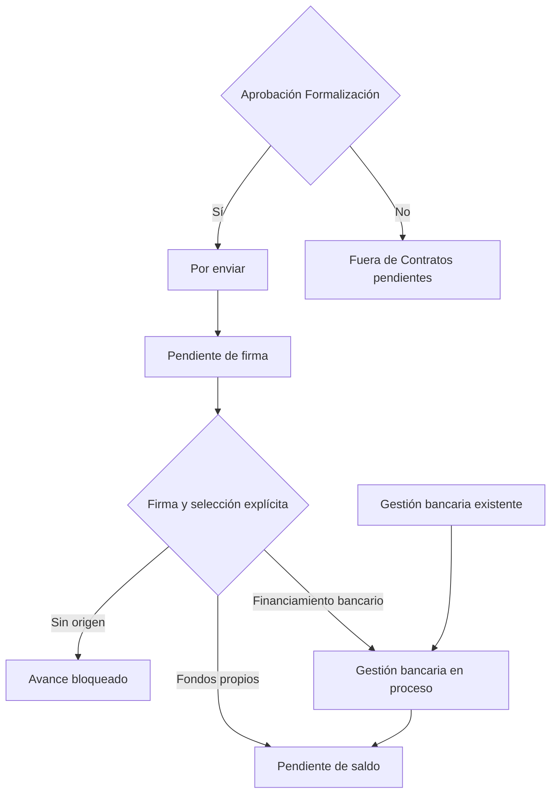

# Formalización: aprobación, origen de fondos y gestión bancaria

## Continuidad: calendario y adéndum — 2026-11-03

Las reglas de fondos/finalización siguientes se conservan. Adéndum agrega una
marca independiente de etapa y aprobaciones; el contrato funcional/esquema actual
vive en [83](83-Adendum-Migracion-065-y-Rollback.md) y
[84](84-Adendum-Manual-Migracion-066-y-Permisos.md). La corrección067 define marcado
manual por defecto para Owner, Jefe General y Jefe de Formalizaciones mediante
grants explícitos; Formalización operativa no lo recibe por defecto.
Marcador/nota y su bitácora no se exponen sin el permiso de lectura propio.
Agendar eventos reutiliza [64](64-Calendario-Global-API-y-Contexto.md): publicación
Microsoft condicionada y posterior al commit CRM, sin enviar contratos ni cambiar
etapas por abrir Outlook. Las pruebas y cifras inferiores son evidencia de su
fecha y no una suite nueva por esta revisión documental.

Alcance aprobado por el propietario el 2026-11-02: solo R1, R2 y R3. No modifica
Leads, otras tarjetas del tablero, NetSuite, ni despliega a producción.

## Contrato y plan de ejecución

1. Reutilizar resolución de orden, autorización, transacciones, secuencia optimista
   e idempotencia de ContractTransitionRepository y su bitácora central.
2. Exigir aprobación de Formalización para Contratos pendientes, manteniendo las
   condiciones de actividad/no caída y los requisitos de firma/envío para avanzar.
3. Agregar la elección explícita y las dos rutas, sin seleccionar valores por defecto.
4. Actualizar consultas, DTO, interfaz, destinos visibles y conteos.
5. Probar ambas fuentes y migración aislada antes de aplicar el esquema autorizado.

El requisito no cambia los prerrequisitos de la acción que otorga la aprobación.
El avance Por enviar → Pendiente de firma permanece. Al salir de Pendiente de firma
se requiere contrato firmado y origen de fondos:



Gestión bancaria permanece para órdenes existentes; no se inventan movimientos.
Las órdenes en etapas posteriores sin origen conservan su etapa. Si vuelven a
Contratos pendientes, deben elegir origen antes de salir nuevamente.

## Campos y propiedad de los datos

| Concepto | BD nueva | BD vieja |
|---|---|---|
| Aprobación Formalización | `crm_sales_order_approval.status_sales_order_approval`, tipo `formalization` | `ordenventa.aprobacion_forma_ov` |
| Origen de fondos de compra | `crm_sales_order.purchase_funds_origin_sales_order` | `ordenventa.origen_fondos_compra_ov` |

Origen usa `ENUM('own_funds','bank_financing') NULL DEFAULT NULL`. El propietario
confirmo `custbody37` (Fondos de Compra): ID 1/"1" = `own_funds` (Propios),
ID 2/"2" = `bank_financing` (Financiado). La sincronizacion v2 aplica este valor
sobre la columna de la fuente autoritativa, dentro de su transaccion y auditoria.
El emisor incluye el valor crudo `custbody37`; `FONDOS` conserva solo el texto de
presentacion. Nulo/cadena vacia explicitos limpian a NULL; un evento anterior sin
la propiedad conserva el dato. Otros valores rechazan la transaccion. El campo
no requiere cambio de esquema ni avanza la etapa por si solo. La edicion CRM
existente no envia cambios a NetSuite; un evento ERP valido posterior vuelve a
aplicar el origen confirmado por NetSuite. Aprobacion usa `custbodyid_firma_rc`.

La API recibe `purchaseFundsOrigin` y audita el valor anterior/nuevo con la identidad
de sesión y la fecha del evento. La actualización y bitácora se confirman juntas.
Un reenvío idempotente no vuelve a registrar la elección.

## Migración 062 y aplicación autorizada

- Nativa: `202611020062_formalization_purchase_funds` agrega la columna, el estado
  `bank_management_in_progress` y su permiso por destino.
- Legacy: CLI separado `scripts/migrate-legacy-purchase-funds.ts`; agrega la
  columna y el mismo estado en su catálogo local, requerido por las FK de sus
  visitas de etapa. El runner nativo conserva su prohibición de acceso legacy.
- El permiso nuevo copia configuración bancaria existente, incluidas denegaciones,
  revocaciones y ventanas de validez. No reactiva configuraciones del destino.
- DDL usa `ALGORITHM=INSTANT` y falla si no está disponible; no fuerza reconstrucción.
- MySQL confirma DDL implícitamente. Catálogo y permisos sí usan transacción; una
  repetición verifica la columna ya creada y continúa sin duplicados.

Comandos de aplicación (ejecutados con aprobación del propietario):

```powershell
pnpm exec tsx scripts/run-schema-migrations.ts --only=202611020062_formalization_purchase_funds
pnpm exec tsx scripts/migrate-legacy-purchase-funds.ts --apply=crmdatabase-api
```

Primero se probó en MariaDB aislada en loopback3309. En el RDS se verificaron ambas
columnas y el ledger062: 0 órdenes nativas; las467 legacy conservaron origen NULL.
Respaldo de esquema/configuración y evidencia de aplicación en
`C:/codex-data/visualizations/2026/11/02/01a19d4c-e647-7f03-a3ce-6e6372aa9366/formalizacion/`.

## Rollback manual, no ejecutado

Requiere aprobación, API detenida y respaldo de todos los valores elegidos y de la
configuración de permisos. No eliminar la bitácora. Antes de revertir el catálogo,
ambas consultas siguientes deben devolver cero; si no, detener y conservar el estado:

```sql
SELECT COUNT(*) FROM CRM_THINK_V2.audit_sales_order_state_event
WHERE from_state_code_sales_order_state_event='bank_management_in_progress'
   OR to_state_code_sales_order_state_event='bank_management_in_progress';
SELECT COUNT(*) FROM `crmdatabase-api`.audit_sales_order_state_event
WHERE from_state_code_sales_order_state_event='bank_management_in_progress'
   OR to_state_code_sales_order_state_event='bank_management_in_progress';
```

Luego, usando conexiones separadas a cada BD y tras respaldar las elecciones:

```sql
-- Conexión CRM_THINK_V2; conservar historial de permisos, desactivar en vez de borrarlo.
START TRANSACTION;
UPDATE sec_permission SET status_permission='inactive'
WHERE code_permission='formalizacion.orders.stage.bank_management_in_progress';
UPDATE sec_user SET permission_version_user=permission_version_user+1
WHERE status_user='active' AND deleted_at_user IS NULL;
DELETE FROM conf_sales_order_state WHERE code_sales_order_state='bank_management_in_progress';
UPDATE conf_sales_order_state SET display_order_sales_order_state=CASE code_sales_order_state
 WHEN 'pending_balance' THEN 5 WHEN 'pending_transfer' THEN 6
 WHEN 'transfer_signed' THEN 7 WHEN 'closed' THEN 8 END
WHERE code_sales_order_state IN ('pending_balance','pending_transfer','transfer_signed','closed');
COMMIT;
ALTER TABLE crm_sales_order DROP COLUMN purchase_funds_origin_sales_order, ALGORITHM=INSTANT;
-- Conexión crmdatabase-api:
START TRANSACTION;
DELETE FROM conf_sales_order_state WHERE code_sales_order_state='bank_management_in_progress';
UPDATE conf_sales_order_state SET display_order_sales_order_state=CASE code_sales_order_state
 WHEN 'pending_balance' THEN 5 WHEN 'pending_transfer' THEN 6
 WHEN 'transfer_signed' THEN 7 WHEN 'closed' THEN 8 END
WHERE code_sales_order_state IN ('pending_balance','pending_transfer','transfer_signed','closed');
COMMIT;
ALTER TABLE ordenventa DROP COLUMN origen_fondos_compra_ov, ALGORITHM=INSTANT;
```

El ledger de una migración ya aplicada conserva el hecho histórico; no ejecutar el
runner esperando que vuelva a aplicar062 después del rollback. Rehabilitar requiere
una nueva migración revisada que reconcilie el permiso inactivo.

## Diagnóstico de disponibilidad

La interfaz configuraba `http://localhost:3000` mientras solo escuchaba el puerto5173.
Las consultas reales funcionaban:186 contratos legacy y3 pendientes de aprobación.
`StageBanners` además mostraba ceros de respaldo con «Sin verificar»; ese cero no
representa datos reales y se sustituye por un indicador de conteo desconocido.
Levantar API local y probar sesión es diferente de desplegar o certificar producción.

## Verificación

- Interfaz:198/198 pruebas enfocadas; typecheck, build, lint y formato del alcance aprobados.
- API:73/73 pruebas de transición y10/10 de conteos; typecheck, build y lint del alcance aprobados.
- Dentro de las pruebas de transición,4 casos InnoDB reales en loopback verificaron
  ambas fuentes/rutas, diff con autor/fecha, idempotencia histórica y rollback por fallo
  de bitácora. La FK del nuevo estado legacy también se probó con inserción aislada
  y rollback. No se crearon ni modificaron órdenes comerciales en el RDS.
- Migración/runner/registro:56/56 pruebas aprobadas después de actualizar la lista062.
- Prueba autenticada de pantalla después de recargar:238 Por enviar,0 Pendientes de
  firma,3 Pendientes de aprobación; banca0/0. Sin «Sin verificar» ni «No disponible».
- RDS: columnas de ambas fuentes verificadas, estado bancario nuevo en ambos
  catálogos y ledger nativo062. Las467 órdenes legacy siguen con origen NULL.
- Revisión independiente final: sin bloqueos del alcance.

Límites de la validación general: la suite API iniciada antes de actualizar la lista
de migraciones terminó con7121 aprobadas,1 fallo en esa lista y204 omitidas; la
aserción se corrigió y su archivo volvió a pasar dentro del lote56/56. La suite
frontend general tuvo fallos ajenos/concurrentes y aserciones anteriores al cambio;
las198 pruebas del alcance se volvieron a ejecutar con éxito. `check-all.cmd` sigue
bloqueado por formato en `SS2_1_LIB_CRM_EjecutarAccion.js` y
`test/integrations/netsuite-suitescript/contract.spec.mjs`, fuera de este cambio.
No se certifica un check global verde ni despliegue productivo.

## Archivos principales

| Área | Archivos | Cambio |
|---|---|---|
| Esquema | `migrations/schema-only/202611020062_formalization_purchase_funds.ts`, `scripts/migrate-legacy-purchase-funds.ts`, `scripts/run-schema-migrations.ts`, `sales-orders.tables.ts` | Campos, catálogos, permiso y registro |
| Comandos | `contract-transition.dto.ts`, `.port.ts`, `.service.ts`, `.repository.ts`, `legacy-contract-transition.writer.ts` | Elección, rutas obligatorias, transacción y auditoría |
| Lecturas | Repositorios y adapters de contratos, seguimiento, Home y tiempos | Aprobación Formalización, origen y conteos bancarios |
| Interfaz | `FormalizationStageEditor.tsx`, `FormalizationHomePage.tsx`, `formalization-order-cards.ts`, `FormalizationRecordProgress.tsx`, servicios de Formalización | Selector, navegación, estado y conteos sin ceros de respaldo |
| Pruebas | `test/migrations/formalization-purchase-funds.spec.ts`, registro de migraciones, pruebas de sales-orders y frontend Formalización | Reglas, ambas fuentes, permisos, bitácora, rollback y presentación |

## Ampliación: cuotas pagadas y salida de Pendientes de saldo

**Antecedente:** la exigencia de cuotas descrita en este apartado fue ampliada por
la tabla final de combinaciones aprobada más abajo. La tabla final prevalece,
incluida la excepción de cierre por Unidad entregada.

Regla adicional solicitada por el propietario: el check NetSuite
`custbody_cuotas_pagadas` corresponde a
`crm_sales_order.installments_fully_paid_sales_order` en la BD nueva y a
`ordenventa.cuotas_pagadas_completo_ov` en la vieja. Ya existen las columnas y el
mapeo de sincronización; no requiere migración ni cambiar SuiteScripts.

- Pendientes de saldo → Traspasos pendientes exige un valor explícito verdadero;
  falso, NULL o desconocido no habilitan el avance. El servidor repite la validación
  bajo el bloqueo de la orden, incluso para cambios excepcionales.
- El usuario puede avanzar con el botón de estado cuando el check está marcado.
- Una edición válida `edit`/`xedit` recibida de NetSuite también puede avanzar
  automáticamente si la etapa persistida es Pendientes de saldo y se conservan
  actividad, aprobación de Formalización y firma requeridas. Se aplican las reglas
  existentes de fuente nativa primero, orden de eventos e idempotencia.
- El cambio del check, la visita de etapa y la bitácora central se confirman en la
  misma transacción. El actor automático es NetSuite; no se inventa un usuario CRM
  ni se reemplaza al responsable comercial por la integración.
- Aclaración explícita del propietario: desmarcar el check no devuelve la orden.
  Conserva la etapa y bloquea avances posteriores. Una orden en Traspasos pendientes
  o una etapa posterior no puede volver a Pendientes de saldo, tampoco mediante
  un movimiento excepcional. Las reversiones autorizadas entre etapas posteriores
  conservan sus permisos y motivo obligatorio; no se confunden con un avance.
- La etapa persistida sigue siendo la fuente de clasificación: no se inventan
  transiciones al consultar ni se reclasifica una orden hacia atrás por desmarcar.
  El listado expone `installmentsFullyPaid` como verdadero/falso/NULL y muestra la
  restricción de avance en el editor compartido.

La regla se utiliza tanto en **Pendientes de seguimiento** del Home como en
`/home/formalization/orders`: ambas pantallas consumen el contrato y editor de
seguimiento compartidos. No se ejecuta backfill ni se alteran órdenes comerciales
en el RDS para probarla; las pruebas de escritura se realizan en datos aislados.

Verificación de esta ampliación:

- API manual y lecturas:149 pruebas aprobadas;6 pruebas InnoDB locales para ambas
  fuentes, bloqueo, avance y prohibición de regresar a saldo.
- Eventos NetSuite:32 pruebas unitarias relacionadas y30 SQL locales aprobadas,
  incluidos avance con check ya marcado, reenvíos, eventos antiguos, conservación
  de responsable y rollback de check/etapa/bitácora/cursor por fallo de auditoría.
- La identidad central de la visita automática usa el mismo hash que los comandos
  manuales, para no duplicar el evento al consultar el historial.
- Interfaz compartida:124 pruebas aprobadas; build con typecheck y lint del alcance
  aprobados. La revisión independiente verificó107 pruebas API y88 del editor.
- Lectura real sin escrituras: fuente nativa0 órdenes; legacy241 en seguimiento,
  muestra25 y relectura exacta con `installmentsFullyPaid` nullable válido. NULL se
  conserva como desconocido, nunca se convierte en confirmación de pago.
- Persistencia local NetSuite, fallback, escritura legacy y bitácora estaban habilitados;
  `/health/live` respondió `ok` al cierre de la prueba de lectura.
- Sin migraciones, cambios a SuiteScripts, despliegues ni escrituras comerciales RDS.
  No se ejecutó una edición real de NetSuite para esta ampliación.

Build y typecheck API finales aprobados. La primera ejecución detectó cambios
concurrentes de Calendario; al resolverse fuera de este alcance, ambas verificaciones
se repitieron con éxito. `check-all.cmd` sigue detenido por formato
en los dos archivos NetSuite indicados arriba; no se modificaron por esta regla.

Archivos adicionales principales: `netsuite-paid-installments.handler.ts`, hook en
`netsuite-order-event.repository.ts`, pruebas `netsuite-paid-installments.spec.ts`
y extensión de `netsuite-order-events.local-sql.spec.ts`. El avance manual y las
lecturas reutilizan los archivos de comandos y seguimiento de la tabla anterior;
el frontend modifica el editor y el parser compartidos y sus pruebas.

## Regla final aprobada: traspaso, firma y cierre

El propietario aprobó aplicar las combinaciones de las imágenes. Cada columna
se evalúa con valores confirmados; NULL/desconocido no equivale a desmarcado.

| Destino | Cuotas pagadas | Unidad traspasada | Llaves entregadas | Unidad entregada |
|---|---|---|---|---|
| Traspasos pendientes | Sí | No | Cualquiera | No |
| Traspaso firmado | Sí | Sí | No | No |
| Formalización cerrada | Cualquiera | Cualquiera | Cualquiera | Sí |

Correspondencias de origen:

| NetSuite | BD nueva | BD vieja |
|---|---|---|
| `custbody_cuotas_pagadas` | `installments_fully_paid_sales_order` | `cuotas_pagadas_completo_ov` |
| `custbody105` | `unit_transferred_sales_order` | `unidad_traspasada_ov` |
| `custbody_entrega_de_llaves` | `keys_delivered_sales_order` | `entrega_llaves_ov` |
| `custbody91` | `unit_delivered_sales_order` | `unidad_entregada_ov` |

La entrega física tiene prioridad para el cierre: no exige cuotas, traspaso ni
llaves marcados. Esto no elimina los requisitos previos de orden activa, aprobación,
firma y autorización del CRM. Cuotas permanece no negociable para los dos destinos
de traspaso, incluso al seleccionar un destino excepcional o una reversión.

`formalization-completion.policy.ts` centraliza la selección de destino para API y
eventos NetSuite. En etapas finales, un destino válido posterior es el siguiente
paso normal (por ejemplo, Unidad entregada permite cerrar desde Pendientes de saldo
sin exigir antes una firma que requiere Unidad entregada desmarcada). Se conserva
el permiso específico del destino; la regla válida no requiere permiso de salto.
La interfaz aplica la misma tabla en su editor compartido y valida el contrato
nullable de los cuatro indicadores.

Los eventos `edit`/`xedit` pueden avanzar desde Pendientes de saldo, Traspasos
pendientes o Traspaso firmado al destino posterior confirmado por los checks.
No hay retrocesos automáticos, reactivación de cerradas ni creación de órdenes.
Las escrituras de flags, visita y auditorías siguen siendo atómicas e idempotentes.

Las dos vistas (Home/seguimiento y `/home/formalization/orders`) usan el mismo
contrato y predicados. Las bandejas específicas y sus conteos exigen la combinación
exacta del destino. Una combinación no contemplada, por ejemplo cuotas y traspaso
marcados, llaves entregadas y unidad no entregada, no se fuerza a una bandeja:
permanece visible en **Todas** según permisos, con aviso de revisión y su etapa
persistida. No se inventan visitas ni fechas durante las lecturas. El cierre anual
mantiene su periodo documentado y añade la exigencia de Unidad entregada marcada.

No requiere migración, backfill ni cambios en los SuiteScripts: los cuatro campos
ya existen y se sincronizan. Las pruebas de escritura siguen usando únicamente la
BD local aislada, sin modificar órdenes comerciales del RDS.

Verificación de la tabla final:

- Política:21 casos aprobados, incluidas las16 combinaciones booleanas y valores
  desconocidos. Frontend:390 pruebas aprobadas, con matriz de256 combinaciones
  verdadero/falso/NULL/ausente y avances directos normales sin permiso de salto.
- API:473 pruebas de órdenes aprobadas,6 omitidas condicionales; después del último
  ajuste de mensajes de siguiente paso,198 pruebas del alcance aprobadas.
- Eventos:36 pruebas unitarias y32 SQL locales aprobadas; comandos manuales:6 SQL
  locales aprobadas. Incluyen ambas fuentes, avance directo a firmado, cierre con
  cuotas falsas/desconocidas, rollback, reenvíos y conservación de etapas.
- Conteos reales de SQL con datos sintéticos: las16 combinaciones por fuente,
  repetidas en tres etapas, conservaron48 filas en Todas;2 elegibles en Traspasos
  pendientes,1 en Traspaso firmado y8 en Cierre. Se ejecutaron exclusivamente
  SELECT en transacciones read-only del RDS MySQL8.4. MariaDB local10.4 no soporta
  JSON_ARRAYAGG, por lo que no se afirma esa verificación de consultas en MariaDB.
- Lecturas reales read-only del Home y seguimiento aprobaron:0 órdenes nativas,
  241 legacy en Todas,238 Por enviar; muestra25 con cuatro flags nullable válidos.
  Evidencias: `completion-query-matrix.json` y `completion-live-read.json` en el
  directorio de artefactos de Formalización indicado arriba.
- Build y typecheck de API e interfaz aprobados, lint del alcance aprobado y
  revisión final sin bloqueos. `check-all.cmd` conserva los dos errores de formato
  NetSuite previos; lint global frontend conserva errores ajenos en NotesInbox y
  PersonalNotes. No se certifica una validación global verde ni una edición real
  de NetSuite para esta ampliación.

## QA distribuida posterior: acciones y permisos

Cinco agentes revisaron roles/guardas HTTP, comandos manuales, interfaz, eventos
NetSuite y revisión independiente. Se añadieron pruebas sin cambiar reglas ni
permisos productivos:60 de roles,6 HTTP de autenticación/CSRF/destino,166 de acciones
manuales,18 del handler NetSuite,2 de concurrencia SQL y1 de doble confirmación UI.
Se actualizaron dos expectativas obsoletas de la ficha/drawer manteniendo pruebas
de navegación, datos del proveedor y revalidación, sin restaurar consultas retiradas.

Resultados focales:299 pruebas del repositorio,511 de interfaz,54 del handler,
8 SQL manuales y32 SQL de eventos aprobadas. La revisión independiente repitió81
casos de política/handler/HTTP con éxito. Configuración de grants consultada con
SELECT read-only: Formalización tiene update y los tres destinos; Jefe de
Formalizaciones tiene además skip. Owner hereda roles activos y Jefe General
depende de módulos seleccionados. Perfiles inactivos/denegados no evitan los guards.

Suites completas: API7520 aprobadas/3 fallidas/216 omitidas; frontend1634 aprobadas/
1 fallida. Las3 fallidas de la migración060, ajena y cambiada concurrentemente,
pasaron en reejecución actual5/5. La expectativa obsoleta del drawer se corrigió
y detalle/layout pasaron12/12. No se atribuye exit0 a las ejecuciones globales iniciales.
Build/typecheck de ambos proyectos y lint API aprobaron. Lint global frontend y
formato global conservan incidencias ajenas; no se hicieron despliegues ni pruebas
comerciales de escritura en RDS/NetSuite.

Informe detallado y límites de evidencia:
`C:/codex-data/visualizations/2026/11/02/01a19d4c-e647-7f03-a3ce-6e6372aa9366/formalizacion/qa-validacion-formalizacion.md`.

## Ayuda contextual en títulos

Inicio y Órdenes muestran un icono de ayuda junto a los títulos de sus tarjetas y
de seguimiento. `formalization-queue-help.ts` centraliza las explicaciones de
aprobación, contratos, banca, saldo, traspasos y cierre anual, basadas en los filtros
reales de ambas fuentes. No cambia condiciones, conteos, permisos ni registros.

Se reutiliza FormHelp con apertura al pasar el mouse o recibir foco de teclado.
La ayuda tiene nombre accesible propio; los títulos conservan su nombre. En
Pendientes de aprobación, la ayuda y el acceso a la bandeja son botones hermanos:
consultar las condiciones no navega ni anida botones interactivos.

Las tarjetas genéricas solo muestran ayuda si reciben helpText; los catálogos que
no lo proporcionan conservan su presentación. Verificación:105 pruebas focales,
build/typecheck, lint y formato del alcance aprobados; comprobación visual en
sesión real de Inicio y `/home/formalization/orders`, sin escrituras comerciales.

## Envío del contrato en la ficha general

La acción existente del drawer se comparte mediante `FormalizationContractSend.tsx`:
la ficha general la muestra inmediatamente después de los datos clave, cuyo último
campo es «Siguiente paso». Conserva correo del cliente, título «Envío del contrato»
y enlace «Abrir Outlook». Solo aparece en Por enviar; sin correo no ofrece enlace.
Abre un borrador dirigido al correo canónico de la orden. No envía correo ni cambia
etapa o bitácora por abrir el enlace. No necesita cambios de API/BD/permisos.

Verificado visualmente en `/home/formalization?orderSource=legacy&orderId=78` sin
abrir Outlook ni enviar mensajes. Tres suites focales aprobaron43 pruebas; build,
typecheck incluido, lint y formato del alcance aprobaron. La ejecución adicional de
`formalization-order-details.spec.tsx` conservó una aserción ajena y desactualizada:
espera `/perfil` aunque la ruta compartida actual es `/home/formalization/perfil`.
No se modificó esa ruta ni su prueba como parte del envío de contrato.

## Agendar eventos desde una orden

La ficha general y el detalle lateral del cliente ofrecen «Agendar evento» cuando
se permite `formalizacion.calendar.assign_lead` («Asignar evento a un lead»),
se conserva la lectura del calendario y el descriptor autoriza crear eventos de
Formalización. Un `deny` explícito prevalece sobre cualquier `allow`; sin el nuevo
permiso no se muestra la acción ni se consultan sus selectores. Reutilizan el formulario
lateral existente, sin salir de la orden. «Relaciones» inicia desplegada con la
orden exacta y su cliente canónico seleccionados y bloqueados; las notas y los
participantes conservan su edición habitual. La referencia se precarga con el
número de transacción de la orden. El lookup autorizado confirma las identidades:
si no encuentra esa orden y un cliente inequívoco, no abre un evento con vínculos
supuestos. La API mantiene la validación y autorización actuales del guardado.
La comprobación visual abre y cierra el formulario sin crear eventos reales.

La API exige `formalizacion.calendar.assign_lead` al agregar un vínculo a lead u
orden de venta en eventos de Formalización, incluso mediante una llamada directa.
Conserva la edición de otros datos y el reenvío u omisión de vínculos ya existentes;
no altera los permisos de otros módulos ni los vínculos a notas.

El 2026-11-03 se aplicó únicamente la migración
`202611030063_formalization_calendar_assign_lead` en `CRM_THINK_V2`, con autorización
expresa. Se verificaron el permiso activo en Formalización → Calendario, sus tres
asignaciones activas a `owner`, `formalizacion` y `jefe_formalizaciones`, una entrada
en el ledger y una en auditoría. No modifica la BD legacy ni excepciones individuales.
Las asignaciones inactivas preexistentes se conservan sin reactivarse.

El runner utiliza solo `up`. Una reversión controlada debe identificar las
asignaciones creadas en la auditoría de 063, revocar únicamente esas asignaciones,
inactivar el permiso e incrementar las versiones de permisos de sus usuarios,
registrando la reversión sin borrar el historial ni las excepciones individuales.
No se ejecutó esa reversión.

El panel lateral que se abre desde el listado de órdenes reutiliza el contenido
del cliente en modo de contacto básico: nombre completo, correo y teléfono.
Incluye «Ver perfil del cliente» y «Agendar evento» con sus permisos independientes,
sin sustituir el bloque «Envío del contrato» ni su acción «Abrir Outlook».
Cada cambio de orden consulta su cliente vinculado y descarta respuestas anteriores;
el formulario de eventos se abre en el mismo panel de trabajo con las relaciones
fijadas. Sus teclas de dirección no cambian la orden que queda detrás.

### WhatsApp del cliente

El contacto compartido del panel de la lista y del detalle del cliente incluye
«Ir a WhatsApp», condicionado a `formalizacion.orders.whatsapp` sin denegación
individual. Usa el teléfono crudo del cliente vinculado y su código de país:
`country_code_contact` en nativa y `codigo_lead` en legacy; cero o vacío no
identifican un país. No obtiene el teléfono del texto de presentación ni del ID
de la orden.

Para Costa Rica, o cuando no se registró país, acepta ocho dígitos locales y
agrega 506. Conserva los prefijos internacionales explícitos `+`/`00`; un país
extranjero sin prefijo internacional requiere corregir el número. Rechaza texto,
extensiones, listas y formatos inválidos. Sin teléfono utilizable muestra el
botón deshabilitado y su explicación. El enlace abre WhatsApp Web en otra pestaña,
sin mensaje prellenado ni envío automático; no confirma que el número tenga una
cuenta activa. Referencia: [formato internacional de WhatsApp](https://faq.whatsapp.com/5913398998672934).

El 2026-11-03 se aplicó únicamente la migración
`202611030064_formalization_order_whatsapp` en `CRM_THINK_V2`, por solicitud expresa.
Se verificaron sus asignaciones activas a `owner`, `formalizacion`,
`jefe_formalizaciones` y `jefe_general`, junto con su ledger y auditoría. Las
cuentas heredan el permiso por rol; se conservan revocaciones y excepciones.
No modifica la BD vieja. La reversión sigue el procedimiento controlado de 063,
identificando los cambios propios de 064 y conservando el historial.

### Edicion independiente de fondos: corte concurrente del 03/11/2026

`GET /formalization/orders/:source/:id/purchase-funds` obtiene una instantanea fresca sin cache; `POST /formalization/orders/purchase-funds` guarda la clasificacion sin enviar contrato, crear visita ni cambiar tiempos de etapa. Ambos exigen sesion, rol habilitado de Formalizacion y `formalizacion.orders.stage.update` efectivo, con alcance propio respetado. La orden debe estar activa/no cancelada.

El cuerpo estricto requiere `source`, `id`, `expectedSequence`, `expectedAuditSequence`, `operationId`, `purchaseFundsOrigin` y `expectedPurchaseFundsOrigin` (nullable). Bajo bloqueo compara version de etapa, valor anterior y secuencia central de auditoria; esta ultima detecta incluso cambios A-B-A. La escritura del origen autoritativo y su auditoria parcial son atomicas; requiere auditoria habilitada. El replay exige mismo actor y contenido anterior/nuevo; reutilizar la operacion con otros datos produce conflicto. Esta clasificacion independiente no sustituye la ruta obligatoria al salir de Contratos ni relaja firma/checks de finalizacion.

Relectura estática posterior del código y las aserciones concurrentes: la instantánea devuelve `sequence` de etapa y `auditSequence` central; el guardado no incrementa la secuencia de etapa y devuelve `purchaseFundsOrigin`, `sequence` y `replayed`. La siguiente instantánea obtiene la secuencia central actualizada. Los snapshots parciales antes/después incluyen `purchaseFundsOrigin`, `stateVersion` y `auditVersion` enviados como expectativas; la escritura central recibe además `expectedSequence=expectedAuditSequence` para rechazar una versión obsoleta.

Las aserciones de edición independiente ya incluyen los tres campos del snapshot y `expectedAuditSequence`. Se inspeccionaron los casos A→B→A y replay con el estado actual distinto del histórico, actor diferente, payload diferente o JSON corrupto. El replay compara el snapshot original con igualdad estructural independiente del orden de claves y no vuelve a escribir. Es coherencia estática observada con el contrato actual; no se ejecutaron estas pruebas, ni se declara aprobada la suite o probada concurrencia SQL. Los resultados históricos superiores conservan su corte.


### Límites de las pruebas de fondos inspeccionadas en el corte congelado

Corte de lectura: **2026-11-03T16:02:13.527338Z**, usando copias congeladas; los cambios posteriores quedan fuera de esta comprobación. El test HTTP nuevo inspecciona metadatos de permiso `formalizacion.orders.stage.update`, paso de la cookie de sesión al servicio, las rutas GET/POST independientes y `Cache-Control:no-store` del POST. Su servicio está sustituido y no instala AuthGuard/CsrfGuard: no demuestra rechazo real por sesión, permiso o CSRF ni persistencia.

El test de servicio usa identidad y repositorio sustituidos: comprueba el permiso independiente de edición, deny, DTO estricto con `expectedAuditSequence` y ausencia de delegación al comando de etapa. Que el servicio remita un origen bajo el permiso del destino no demuestra que esa combinación supere la ruta bancaria del repositorio. El test legacy usa DummyDriver y transacción simulada: verifica el SQL acotado a `origen_fondos_compra_ov`, sin visita de etapa, y rechazo previo al SQL con fallback/escritura/destino deshabilitados. No ejecuta ese UPDATE contra MySQL ni prueba rollback real. Ninguno de estos tres archivos se ejecutó durante la reconciliación documental.


## Conexion de custbody37 — correccion del 03/11/2026

La libreria SuiteScript unificada `SS2_1_LIB_CRM_habita.js` agrega `custbody37` a
`bodyValues` (getValue), tanto en GET como en el snapshot de eventos. El mapping
declarativo incorpora ambas columnas existentes y el escritor/auditoria lo consumen
sin otro camino de persistencia. Pruebas focalizadas incluyen emisor AMD real,
conversion de IDs, ausencia/vacio/invalidos y SQL de UPDATE/auditoria de ambos
destinos con DummyDriver. No son prueba de una escritura real en RDS ni de la
entrega desde NetSuite. La activacion requiere publicar API y SuiteScript y completar
los despliegues/IDs pendientes; no se ejecuta backfill al consultar una orden.

El emisor rechaza un valor ilegible (undefined, objeto o ID no confirmado) antes de
normalizarlo a escalar; no lo convierte en vacio. El hash temporal distingue la
propiedad ausente (preservar) del NULL explicito (borrar), y conserva equivalencia
entre ID numerico/cadena y entre null/cadena vacia. Pruebas focalizadas: 66 aprobadas
con VM del productor y repositorio/driver sustituidos; no acreditan entrega real.
