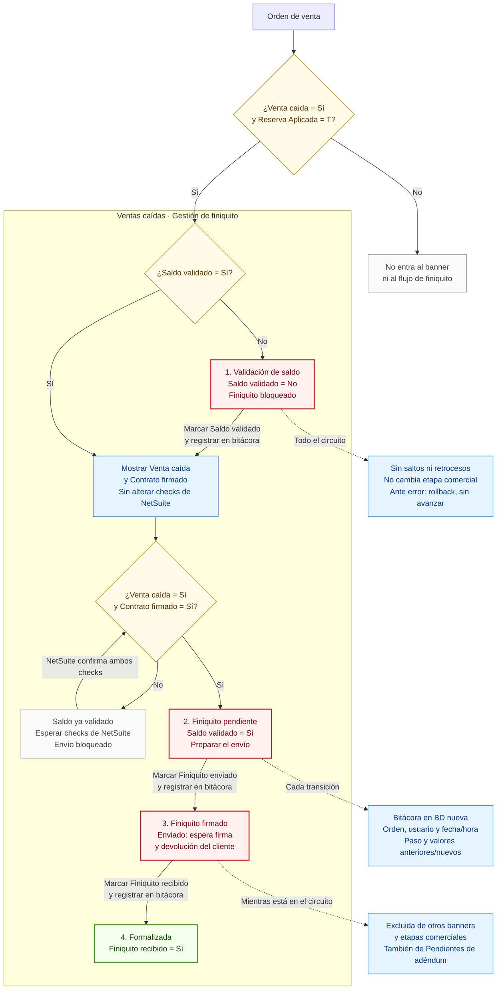

# Ventas caídas · Gestión de finiquito

**Plan funcional aprobado e implementación local.** Este diagrama describe las reglas;
no certifica que el banner o todo el flujo ya estén implementados o desplegados.

Se conserva el nombre actual **Finiquito firmado**. En este plan significa
**finiquito enviado, pendiente de firma y devolución**. El posible cambio de
nombre a «Finiquito enviado · Pendiente de firma» queda sin aplicar.

## Reglas comunes

- Misma lógica para una orden en la BD nueva o en la BD vieja. La bitácora
  permanece en la BD nueva en ambos casos.
- Una venta caída sin `custbody209 = T`, o con reserva desconocida, no entra.
  En legacy se usa `reserva_ov`, confirmado por negocio como destino de `custbody209`; en nativa se usa `reservation_applied_sales_order`.
- Checks de entrada ERP: `custbody43` (Venta caída) y `custbody209`
  (Reserva Aplicada). Contrato firmado corresponde a `custbody90`.
- La exclusión incluye Pendientes de aprobación, Por enviar, Pendiente de firma,
  Gestión bancaria, Gestión bancaria en proceso, Pendiente de saldo, Traspaso
  pendiente, Traspaso firmado, Formalizaciones cerradas este año y Pendientes
  de adéndum.
- Antes de validar saldo no se muestran las etiquetas de este circuito
  «Venta caída» y «Contrato firmado»; sus valores ERP permanecen intactos.
- Validar saldo no marca automáticamente Contrato firmado. Si falta ese check,
  se conserva la validación y se bloquea el envío hasta que NetSuite lo confirme.
- Marcar «Finiquito enviado» registra un envío realizado; no afirma que Habita
  haya enviado un correo automáticamente.
- «Formalizada» cierra este circuito de finiquito; no convierte la venta caída
  en una venta activa ni la agrega al banner comercial de cierres.

## Referencias verificadas

- Nombres actuales del banner: `apps/frontend/src/modules/home/FormalizationHomePage.tsx`,
  componente `SettlementPreviewBanner` (conectado a conteos y colas reales).
- Estado local, mapeo `custbody209`, migración075 y pendientes operativos:
  [Reserva Aplicada](Reserva-Aplicada-075.md).
- Reglas funcionales: instrucciones y aclaraciones del propietario en este chat
  del 12 de noviembre de 2026; este archivo no reemplaza esas decisiones por
  el comportamiento verificado. Implementación y migración076: [Finiquito076](Finiquito-076.md).

