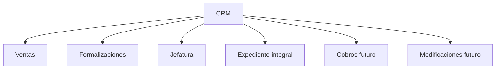

# 00 - Indice de Arquitectura Frontend


Perfil completo: [contrato y verificación](../../api/Arquitectura/77-Perfil-Completo-Lead.md). Ruta `/perfil`, botón condicionado por `lead.profile.read`.
## Entrada vigente - 2026-11-02

[30 - Inventario contrastado](30-Estado-Frontend-Verificado.md) reúne las rutas,
seis áreas de módulos, siete grupos de servicios y clasificación de los 34
documentos de Arquitectura. Leer con [ley frontend](00-Producto-CRM-TINK-y-P0-Frontend.md)
y la ley API. El HEAD revisado es `fcbf0c2`; los commits y cambios locales se
distinguen de pruebas nuevas y despliegue.

Formalización ya lee capítulos confirmados de NetSuite, cliente, expediente e
historial; Calendario ya tiene formulario/relaciones/invitados CRM; Notas ya
ofrece Select de cliente/lead y orden. No son, respectivamente, solo consola DEV,
maqueta o propuesta de vinculación. Resumen de Formalización continúa retirado.
Entradas especializadas: [04 - Cliente](04-API-Client-y-Estado.md),
[05 - Pruebas](05-Testing-Frontend.md), [16 - Notas](16-UX-Notas-Adhesivas-y-Anotaciones.md),
[Calendario global](Calendario-Global-Frontend.md), [19 - Mapa](19-Mapa-de-Implementacion-Frontend.md)
y [27 - Evidencia](27-Entrega-Administracion-y-QA.md).

Los cortes fechados inferiores se conservan como historia. Una frase de maqueta,
pausa inicial o calendario solo esquema no prevalece sobre el inventario actual.
Los blueprints de CRUD de Leads, SLA, oportunidades y financiero siguen futuros;
documentarlos no crea esas pantallas ni certifica integraciones externas.

## Antecedentes de navegación documental

Implementación y verificación local: [68 API - Vincular notas a clientes/leads y órdenes](../../api/Arquitectura/68-Plan-Notas-Vinculos-Clientes-y-Ordenes.md).
Incluye selectores sin elegir BD y resumen en tarjetas, hojas y conversación.

Estado vigente del 29/10: [30 - Inventario frontend](30-Estado-Frontend-Verificado.md)
y [16 - Notas personales y colaborativas](16-UX-Notas-Adhesivas-y-Anotaciones.md).
El [QA67](../../api/Arquitectura/67-Plan-QA-Regresiones-20261029.md) registra
correcciones de expectativas de permisos/navegación, checks de proyecto aprobados
y límites pendientes de Redis, carga y aceptación con dos cuentas reales.
Los cortes fechados inferiores conservan valor histórico; no describen el
calendario ni las notas actuales como simples maquetas o etapas pendientes.

Notas: [66 - Seguimiento colaborativo](../../api/Arquitectura/66-Notas-Enterprise-Seguimiento.md) documenta responsables,
vencimientos, recordatorios personales, ubicaciones e historial con migraciones052/053.

Correcciones vigentes de Formalización: [65 - Roles y recuperación](../../api/Arquitectura/65-Formalizacion-Correcciones-Roles-y-Recuperacion.md).
Ambos roles gestionan todas las órdenes con permiso; se corrige actualización
posterior, revocación, operación incierta y recorrido visual.

Detalle de Formalización 2026-10-28: [Ver orden de venta](../../api/Arquitectura/64-Formalizacion-Permiso-Ver-Orden.md)
es independiente de los permisos de banners/listas. Una URL directa usa lectura
exacta del registro, sin solicitar el listado general.

Cierre transversal y límites de verificación: [55 - Revisión documental integral](../../api/Arquitectura/55-Revision-Documental-Integral-20261027.md).

## Estado contrastado - 2026-10-27

[30 - Estado frontend verificado](30-Estado-Frontend-Verificado.md) inventaría las rutas, contratos y límites actuales: Captación conectada, seguimiento y cambio protegido de etapa de Formalización. Los cortes fechados siguientes son antecedentes; sus cifras de QA no se reejecutaron en esta revisión documental.


Captacion conectada (2026-10-26): API, directorios y fotos reales; la demo anterior
queda historica. Ver [53 - Reporte API](../../api/Arquitectura/53-Captacion-Leads-Reporte-Federado.md).

Antecedente sustituido: Captacion de leads (2026-10-26), maqueta interactiva aislada, sin API/BD. Alcance
y limites en [ley de producto](00-Producto-CRM-TINK-y-P0-Frontend.md) y
[27 - QA](27-Entrega-Administracion-y-QA.md). No sustituye datos reales de Inicio.


## Lectura vigente y cobertura - 2026-10-23

[49 - Estado actual y cierre documental](../../api/Arquitectura/49-Estado-Actual-y-Cierre-Documental.md) centraliza el plan aplicado, la revision de 97 Markdown, el recorrido extremo a extremo y los pendientes reales. Inventario frontend: [19](19-Mapa-de-Implementacion-Frontend.md) y [27](27-Entrega-Administracion-y-QA.md). Mercadeo conectado: [46](../../api/Arquitectura/46-Mercadeo-Resumen-Leads.md) y [48](../../api/Arquitectura/48-Mercadeo-Metricas-Citas.md). Calendario nativo solo esquema: [47](../../api/Arquitectura/47-Calendario-Compartido-Esquema.md); distinto de la simulacion de Formalizacion.

## Jefaturas por modulos - 2026-10-23

[42 - Jefaturas](../../api/Arquitectura/42-Jefaturas-Modulos-y-Permisos.md):
Jefe General con modulos seleccionados por empleado; jefes de area con techo
modular, permisos heredados y excepciones individuales. La navegacion consume
modulos/permisos efectivos del API; el editor conserva asignaciones directas.

## Owner efectivo y denegaciones - 2026-10-23

[41 - Owner](../../api/Arquitectura/41-Owner-Herencia-y-Denegaciones.md): perfil
con roles heredados desde la politica persistida. Etapas requieren Formalizacion
efectiva y `formalizacion.home.stages.read`; deny individual prevalece tambien
para Owner. No hay bypass de Owner en el frontend ni asignaciones fisicas masivas.

## Resumen de etapas de Home - 2026-10-23

[40 - Home y rendimiento](../../api/Arquitectura/40-Formalizacion-Home-Resumen-y-Rendimiento.md):
un consumidor agregado para contratos y los cinco indicadores posteriores,
requiere rol efectivo activo Formalizacion y permiso de etapas sin deny; Owner puede heredar ese rol desde el API. Aprobaciones conserva su permiso.
Preload por numero, relectura al entrar/recuperar foco y ausencia de cache de
contadores. No se habilitan bandejas reales ni acciones. Los resultados y
limites de esta entrega se registran en 40; los cortes anteriores que describen
ceros provisionales conservan su valor historico.

## Consolidacion historica - 2026-10-22, sustituida por el resumen del 2026-10-23

Actualizacion posterior: [Contratos conectado por rol](29-Formalizacion-Reunion-Ajustes.md#contratos-conectado-por-rol---2026-10-22). Segundo banner operacional con subtotales API, preload/error y log DEV; solo rol formalizacion activo. Listado y acciones de ordenes aun no conectados al frontend.

Entradas actuales: [resumen](01-Resumen-Frontend.md), [mapa](19-Mapa-de-Implementacion-Frontend.md), [25 - Continuidad](25-Continuidad-Administracion.md), [26 - Sistema visual Proyectos](26-Projects-Design-System.md), [27 - Entrega/QA](27-Entrega-Administracion-y-QA.md), [28 - Recorrido Formalizacion](28-Formalizacion-Recorrido-Visual.md), [29 - Reunion](29-Formalizacion-Reunion-Ajustes.md) y [29 - Navegacion/recuperacion/seguimiento](29-Navegacion-Recuperacion-y-Seguimiento.md).

La [remediacion API/frontend](../../api/Arquitectura/Reauditoria-54-Plan-y-Resultados.md#plan-central-f01-f13---2026-10-23) conserva sus resultados y limites fechados. El corte anterior tenia dos banners conectados y cinco provisionales; el resumen agregado del 2026-10-23 lo sustituye. Bandejas vacias: conservar Home-only sin activar list/send/revert. Las propuestas de herramientas/carpetas futuras no describen dependencias instaladas.

### Base de continuidad - 2026-10-13

[27 - Entrega de Administracion y QA](27-Entrega-Administracion-y-QA.md) describe filtros, paginacion, cache, comparacion, roles y auditoria vigentes. [36 - Registro API](../../api/Arquitectura/36-Registro-Entrega-Administracion.md) enlaza cada solicitud con implementacion, evidencia y pendientes; [37 - Auditoria y conflictos](../../api/Arquitectura/37-Auditoria-Trazabilidad-y-Conflictos.md) documenta antes/despues y errores. Las entradas anteriores son antecedentes fechados, no una certificacion actual de cierre.

## Projects Design System - Mandatory

Read [26 - Enterprise UX Rules and Replication Guide](26-Projects-Design-System.md) before changing Projects colors, filters, table, drawer or modals. This is the single reusable reference for typography, density, responsive cards, interactions, forms and preloaders as well as colors. Its token roles and contrast overrides are binding within Projects only; historical shell palettes do not override it. Replication to another module requires explicit scope approval.

## Implementation Update - 2026-10-09

Current shared catalog SearchPanes, batch pagination, saved state and provider-specific Drawers are documented in [25 - Continuity](25-Continuidad-Administracion.md). Read [release notes](../../../CHANGELOG.md), [catalog API/schema](../../api/Arquitectura/35-Catalog-API-and-Schema.md) and [migration runbook](../../api/Arquitectura/03-Base-Datos-y-Migracion.md) before assuming full ETL or global identifier uniqueness is implemented.

## Entrada de continuidad 2026-10-08

Leer [README raiz](../../../README.md) y [25 - Continuidad Administracion](25-Continuidad-Administracion.md). Esta guia agrega el inventario actual, rutas reales, contratos, limitaciones, QA y pasos siguientes.

Los documentos 08/18/19 se conservan como antecedentes de blueprint y no describen todo el runtime administrativo actual. Los ADR iniciales sobre TanStack Query, Zustand y Tailwind expresan direccion; el runtime actual usa React/Vite, Ant Design y DataTables. No instalar herramientas para hacer coincidir el blueprint.

[34 - Cierre API](../../api/Arquitectura/34-Cierre-Operativo-Administracion-P0-S1.md) centraliza decisiones transversales, evidencia y pendientes. La documentacion comercial sigue siendo futura hasta cierre administrativo y contrato NetSuite -> API.


## Proposito

Este indice permite navegar la documentacion funcional y tecnica del frontend del CRM.

La documentacion debe ser entendible para ingenieros, analistas, usuarios operativos y personas que no conocen el sistema actual.

## Lectura cero

Antes de leer cualquier otro documento frontend, abrir primero la ley canonica de producto y despues el addendum visual:

```txt
apps/api/Arquitectura/00-Producto-CRM-TINK-y-P0.md
00-Producto-CRM-TINK-y-P0-Frontend.md
```

Si `00-Producto-CRM-TINK-y-P0-Frontend.md` contradice a `apps/api/Arquitectura/00-Producto-CRM-TINK-y-P0.md`, gana la ley canonica del producto.

Si `00-Producto-CRM-TINK-y-P0-Frontend.md` contradice a este indice, `AGENTS.md`, una skill, un documento de UX o cualquier documento futuro, gana `00-Producto-CRM-TINK-y-P0-Frontend.md` dentro del frontend hasta que el dueno del producto apruebe una nueva version.

## Regla de uso

Antes de crear pantallas, formularios, tablas, filtros, permisos visibles o flujos de usuario, leer primero `00-Producto-CRM-TINK-y-P0-Frontend.md`, despues este indice y luego los documentos relacionados.

## Lectura obligatoria P0-S1A por orden

0. `00-Producto-CRM-TINK-y-P0-Frontend.md`
1. `22-UX-Identidad-Usuarios-Roles-P0-S1.md`
2. `24-Contrato-Visual-Identidad-P0-S1.md`

Si hay pelea entre estos documentos, gana `00-Producto-CRM-TINK-y-P0-Frontend.md`.

## Consulta tecnica P0-S1A

Estos documentos se consultan solo cuando se revise seguridad, estado frontend o preparacion de implementacion. No agregan alcance nuevo:

1. `21-Seguridad-Autenticacion-BFF-y-Sesion.md`
2. `23-Regla-IDs-Canonicos-y-Proveedores-Frontend.md`
3. `18-P0-Direccion-Frontend-Construccion-Pausada.md`
4. `19-Mapa-de-Implementacion-Frontend.md`
5. `14-Modularizacion-Frontend-por-Areas-y-Roles.md`

## Lectura futura, fuera de P0-S1

Estos documentos existen para conservar vision, no para autorizar implementacion en P0-S1:

1. `15-UX-Calendarios-por-Area-y-Supervision.md`
2. `16-UX-Notas-Adhesivas-y-Anotaciones.md`
3. `17-UX-Dashboard-Leads-SLA-y-Perdida.md`
4. `20-Alcance-P0-Vertical-Leads-Frontend.md`

Solo se leen cuando `00-Producto-CRM-TINK-y-P0-Frontend.md` o una decision aprobada por el dueno del producto habilite ese alcance.

Nota: `14-Modularizacion-Frontend-por-Areas-y-Roles.md` se consulta desde P0-S1A solo para entender la separacion de `auth`, homes, menus y contextos operativos. Esa consulta no autoriza construir pantallas comerciales.

## Documentos

| Archivo | Para que sirve |
| --- | --- |
| `00-Producto-CRM-TINK-y-P0-Frontend.md` | Ley superior de producto frontend: que UI somos, que no somos, P0-S1 y prohibiciones actuales. |
| `01-Resumen-Frontend.md` | Resume la decision tecnica principal del frontend. |
| `02-Arquitectura-Frontend.md` | Explica estructura React, modulos y organizacion. |
| `03-UI-UX-CRM.md` | Define criterios visuales y experiencia diaria del CRM. |
| `04-API-Client-y-Estado.md` | Define contratos, TanStack Query y estado frontend. |
| `05-Testing-Frontend.md` | Define pruebas esperadas del frontend. |
| `06-ADRs-Frontend.md` | Guarda decisiones arquitectonicas del frontend. |
| `07-Skills-Codex-Instaladas.md` | Lista skills locales y su uso esperado. |
| `08-Revision-Blueprint-y-Siguiente-Paso.md` | Resume revision del blueprint desde UI. |
| `09-Decisiones-P0-UX-Permisos-y-Preguntas.md` | Guarda decisiones P0 de UX, permisos y dudas. |
| `10-Contrato-Canonico-Frontend.md` | Regla de no usar nombres legacy/proveedor en UI. |
| `11-UX-Bitacora-Acciones-y-Timeline-Lead.md` | Define timeline, bitacora y filtros del lead. |
| `12-Diccionario-Funcional-y-Acciones-CRM.md` | Define como documentar acciones y flujos funcionales. |
| `13-Flujo-Comercial-CRM.md` | Explica flujo Lead -> Oportunidad -> Estimacion -> Orden de Venta -> Contrato. |
| `14-Modularizacion-Frontend-por-Areas-y-Roles.md` | Define separacion de UI por contextos operativos, homes, menus, ventas, formalizaciones, cobros, mercadeo, soporte, jefatura y modulos compartidos. |
| `15-UX-Calendarios-por-Area-y-Supervision.md` | Define calendarios separados por area y vista consolidada de jefatura. |
| `16-UX-Notas-Adhesivas-y-Anotaciones.md` | Define UX, librerias y reglas para notas adhesivas/anotaciones contextuales por vista, entidad y accion. |
| `17-UX-Dashboard-Leads-SLA-y-Perdida.md` | Define dashboard ejecutivo, bandejas de leads nuevos/atencion, pausa, perdida y reportes para jefatura. |
| `18-P0-Direccion-Frontend-Construccion-Pausada.md` | Documento corto de direccion P0 frontend; identidad esta activa y el alcance comercial sigue bloqueado. |
| `19-Mapa-de-Implementacion-Frontend.md` | Mapa practico de carpetas, responsabilidades, dependencias permitidas y primer vertical slice del frontend. |
| `20-Alcance-P0-Vertical-Leads-Frontend.md` | Alcance comercial futuro de leads: listar, crear, detalle y timeline despues de cerrar identidad. |
| `21-Seguridad-Autenticacion-BFF-y-Sesion.md` | Regla obligatoria de sesion frontend: BFF, cookies seguras, prohibicion de tokens en storage y manejo CSRF. |
| `22-UX-Identidad-Usuarios-Roles-P0-S1.md` | Primera compuerta frontend: usuarios, autenticacion, roles y permisos antes de pantallas de leads. |
| `23-Regla-IDs-Canonicos-y-Proveedores-Frontend.md` | Regla frontend: usar public ids/contratos canonicos del CRM, nunca ids de proveedores externos. |
| `24-Contrato-Visual-Identidad-P0-S1.md` | Contrato visual de identidad: pantallas permitidas, estados, textos, roles, areas y permisos visibles. |

## Mapa rapido de implementacion

Antes de crear o modificar pantallas, componentes, hooks o clientes API, abrir:

```txt
00-Producto-CRM-TINK-y-P0-Frontend.md
22-UX-Identidad-Usuarios-Roles-P0-S1.md
24-Contrato-Visual-Identidad-P0-S1.md
14-Modularizacion-Frontend-por-Areas-y-Roles.md
```

Esa lectura define:

- que puede mostrar el runtime frontend de identidad;
- que queda bloqueado;
- que contrato visual de identidad manda;
- como se separan `auth`, homes, menus y contextos operativos;
- por que leads sigue fuera.

El primer slice fue identidad P0-S1A; Administracion y Formalizacion parcial se incorporaron posteriormente. El documento `20-Alcance-P0-Vertical-Leads-Frontend.md` sigue siendo futuro, no entrega implementada.

## Formalizacion: reunion y ajustes pendientes

- [29-Formalizacion-Reunion-Ajustes.md](29-Formalizacion-Reunion-Ajustes.md): registro de los once puntos aportados en reunion, diferencias frente a la maqueta y definiciones pendientes. Solo documentacion; no implementacion.
- [28-Formalizacion-Recorrido-Visual.md](28-Formalizacion-Recorrido-Visual.md): alcance y comprobacion de la maqueta anterior. No acredita cumplimiento de los nuevos ajustes de reunion.

## Flujo comercial oficial


Resumen para usuarios:

Un cliente siempre inicia como lead. Si avanza, se convierte en oportunidad, luego se trabaja una estimacion, luego una orden de venta y finalmente queda como contrato firmado.

Resumen para UI:

La pantalla debe mostrar el estado actual, el proximo paso disponible y el historial de lo que ya paso.

## Separacion por areas




## Authorized Marketing Home read extension - 2026-10-23

The owner authorized real lead aggregates for Marketing Home through
`GET /marketing/home/summary?period=day|week|month|year`. Read native leads first,
then the optional legacy adapter, and produce one JSON without copying records.
Count all leads created in the interval regardless of current status. Preserve
permission scopes, canonical seller/project identities and local public-ID photos.
Appointment metrics are now authorized as read-only calendar queries: native events first, then legacy Cita events, attributed through the lead owner/project. No imports or calendar mutations. See `apps/api/Arquitectura/48-Mercadeo-Metricas-Citas.md` (repository-relative).
This scoped authorization supersedes historical mock-only restrictions for this
summary only; it authorizes no imports, business mutations, migrations or deployment.
API contract and verification: `apps/api/Arquitectura/46-Mercadeo-Resumen-Leads.md`
(relative to the repository root).


Lectura de orden ampliada 2026-10-27: [56 API - Bitácora de orden y expediente](../../api/Arquitectura/56-Orden-Bitacora-y-Expediente-Lectura.md). Dos paneles laterales relacionados con la orden autorizada, sin nuevas escrituras.

### Notas personales, etapa3 (27 octubre2026)

[58 API](../../api/Arquitectura/58-Notas-Etapa3-Interfaz-Personal.md): icono junto a campana, Drawer derecho, Home y orden nativa de Formalizacion; contenido propio y layout/PIN por dispositivo. Clientes tipados, reintentos con mismo identificador, conflictos explicitos y sin datos ficticios de fallback. Compartir/respuestas/campanita implementados en etapa4 (contrato60); copia legacy pendiente.

Correccion vigente de notas: [59 API](../../api/Arquitectura/59-Notas-Contexto-Opcional-y-Vistas.md). Creacion desde cualquier pantalla, personal por defecto, checkbox opcional para vista registrada/orden native o legacy; vincular no comparte. Contexto incluye source+id y siempre revalida acceso; sin URLs arbitrarias/imports.

Actualización 2026-10-27: la orden completa incorpora Acciones de la etapa debajo del avance; el panel lateral reutiliza el mismo editor. Solo muestra la acción siguiente si existe permiso del destino; el selector excepcional requiere `formalizacion.orders.stage.skip` y un motivo para saltos o retrocesos. El éxito recarga orden y contadores desde el API. No envía correo ni modifica NetSuite. Contrato y verificación: API Arquitectura/52-Etapas-Responsables-y-Tiempos.md, migración 043. Verificación focalizada: 77 pruebas frontend y 110 API; sin ejecutar cambios de estado sobre órdenes reales.

### Notas colaborativas, etapa4 (27 octubre2026)

[60 API](../../api/Arquitectura/60-Notas-Etapa4-Colaboracion-y-Notificaciones.md): invitación al crear/después, conversación, menciones, bandejas, campana y lectura individual. Vincular no comparte. La copia legacy sigue pendiente.

Estado vigente de notas 2026-10-28: [implementación realtime y límites](../../api/Arquitectura/62-Notas-Tiempo-Real-Implementacion.md). Provider único por sesión, campana y conversación actualizadas, preservación de borradores, lectura explícita y revocación. La invitación no concede acceso al registro: contexto restringido se recibe como null. Reconciliación REST al reconectar; copia legacy inactiva.

Calendario vigente 28/10/2026: [calendario global por módulo](Calendario-Global-Frontend.md), superposición autorizada, formularios nativos, UTC y reintentos. Aplicación de esquema y pendiente DBA: [64 API](../../api/Arquitectura/64-Calendario-Global-API-y-Contexto.md).
