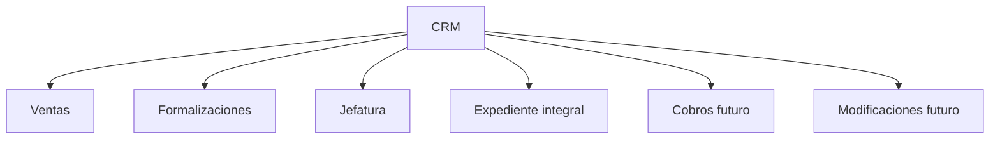

# 00 - Indice de Arquitectura Frontend

## Jefaturas por modulos - 2026-10-23

[42 - Jefaturas](../../api/Arquitectura/42-Jefaturas-Modulos-y-Permisos.md):
Jefe General con modulos seleccionados por empleado; jefes de area con techo
modular, permisos heredados y excepciones individuales. La navegacion consume
modulos/permisos efectivos del API; el editor conserva asignaciones directas.

## Owner efectivo y denegaciones - 2026-10-23

[41 - Owner](../../api/Arquitectura/41-Owner-Herencia-y-Denegaciones.md): perfil
con roles heredados desde la politica persistida. Etapas requieren Formalizacion
efectiva y `formalizacion.home.stages.read`; deny individual prevalece tambien
para Owner. No hay bypass de Owner en el frontend ni asignaciones fisicas masivas.

## Resumen de etapas de Home - 2026-10-23

[40 - Home y rendimiento](../../api/Arquitectura/40-Formalizacion-Home-Resumen-y-Rendimiento.md):
un consumidor agregado para contratos y los cinco indicadores posteriores,
exclusivo de rol activo Formalizacion; aprobaciones conserva su permiso.
Preload por numero, relectura al entrar/recuperar foco y ausencia de cache de
contadores. No se habilitan bandejas reales ni acciones. Los resultados y
limites de esta entrega se registran en 40; los cortes anteriores que describen
ceros provisionales conservan su valor historico.

## Consolidacion vigente - 2026-10-22

Actualizacion posterior: [Contratos conectado por rol](29-Formalizacion-Reunion-Ajustes.md#contratos-conectado-por-rol---2026-10-22). Segundo banner operacional con subtotales API, preload/error y log DEV; solo rol formalizacion activo. Listado y acciones de ordenes aun no conectados al frontend.

Entradas actuales: [resumen](01-Resumen-Frontend.md), [mapa](19-Mapa-de-Implementacion-Frontend.md), [25 - Continuidad](25-Continuidad-Administracion.md), [26 - Sistema visual Proyectos](26-Projects-Design-System.md), [27 - Entrega/QA](27-Entrega-Administracion-y-QA.md), [28 - Recorrido Formalizacion](28-Formalizacion-Recorrido-Visual.md), [29 - Reunion](29-Formalizacion-Reunion-Ajustes.md) y [29 - Navegacion/recuperacion/seguimiento](29-Navegacion-Recuperacion-y-Seguimiento.md).

La [remediacion API/frontend](../../api/Arquitectura/Reauditoria-54-Plan-y-Resultados.md#plan-central-f01-f13---2026-10-23) conserva el plan F01-F13 con resultados nuevos pendientes y evidencia historica separada. Dos banners reales: aprobaciones protegido por `formalizacion.home.approvals.read` y contratos por rol activo `formalizacion`; cinco indicadores provisionales y ningun seguimiento operacional. Bandejas vacias: conservar Home-only sin activar list/send/revert. Las propuestas de herramientas/carpeta futuras no describen dependencias instaladas.

### Base de continuidad - 2026-10-13

[27 - Entrega de Administracion y QA](27-Entrega-Administracion-y-QA.md) describe filtros, paginacion, cache, comparacion, roles y auditoria vigentes. [36 - Registro API](../../api/Arquitectura/36-Registro-Entrega-Administracion.md) enlaza cada solicitud con implementacion, evidencia y pendientes; [37 - Auditoria y conflictos](../../api/Arquitectura/37-Auditoria-Trazabilidad-y-Conflictos.md) documenta antes/despues y errores. Las entradas anteriores son antecedentes fechados, no una certificacion actual de cierre.

## Projects Design System - Mandatory

Read [26 - Enterprise UX Rules and Replication Guide](26-Projects-Design-System.md) before changing Projects colors, filters, table, drawer or modals. This is the single reusable reference for typography, density, responsive cards, interactions, forms and preloaders as well as colors. Its token roles and contrast overrides are binding within Projects only; historical shell palettes do not override it. Replication to another module requires explicit scope approval.

## Implementation Update - 2026-10-09

Current shared catalog SearchPanes, batch pagination, saved state and provider-specific Drawers are documented in [25 - Continuity](25-Continuidad-Administracion.md). Read [release notes](../../../CHANGELOG.md), [catalog API/schema](../../api/Arquitectura/35-Catalog-API-and-Schema.md) and [migration runbook](../../api/Arquitectura/03-Base-Datos-y-Migracion.md) before assuming full ETL or global identifier uniqueness is implemented.

## Entrada de continuidad 2026-10-08

Leer [README raiz](../../../README.md) y [25 - Continuidad Administracion](25-Continuidad-Administracion.md). Esta guia agrega el inventario actual, rutas reales, contratos, limitaciones, QA y pasos siguientes.

Los documentos 08/18/19 se conservan como antecedentes de blueprint y no describen todo el runtime administrativo actual. Los ADR iniciales sobre TanStack Query, Zustand y Tailwind expresan direccion; el runtime actual usa React/Vite, Ant Design y DataTables. No instalar herramientas para hacer coincidir el blueprint.

[34 - Cierre API](../../api/Arquitectura/34-Cierre-Operativo-Administracion-P0-S1.md) centraliza decisiones transversales, evidencia y pendientes. La documentacion comercial sigue siendo futura hasta cierre administrativo y contrato NetSuite -> API.


## Proposito

Este indice permite navegar la documentacion funcional y tecnica del frontend del CRM.

La documentacion debe ser entendible para ingenieros, analistas, usuarios operativos y personas que no conocen el sistema actual.

## Lectura cero

Antes de leer cualquier otro documento frontend, abrir primero la ley canonica de producto y despues el addendum visual:

```txt
apps/api/Arquitectura/00-Producto-CRM-TINK-y-P0.md
00-Producto-CRM-TINK-y-P0-Frontend.md
```

Si `00-Producto-CRM-TINK-y-P0-Frontend.md` contradice a `apps/api/Arquitectura/00-Producto-CRM-TINK-y-P0.md`, gana la ley canonica del producto.

Si `00-Producto-CRM-TINK-y-P0-Frontend.md` contradice a este indice, `AGENTS.md`, una skill, un documento de UX o cualquier documento futuro, gana `00-Producto-CRM-TINK-y-P0-Frontend.md` dentro del frontend hasta que el dueno del producto apruebe una nueva version.

## Regla de uso

Antes de crear pantallas, formularios, tablas, filtros, permisos visibles o flujos de usuario, leer primero `00-Producto-CRM-TINK-y-P0-Frontend.md`, despues este indice y luego los documentos relacionados.

## Lectura obligatoria P0-S1A por orden

0. `00-Producto-CRM-TINK-y-P0-Frontend.md`
1. `22-UX-Identidad-Usuarios-Roles-P0-S1.md`
2. `24-Contrato-Visual-Identidad-P0-S1.md`

Si hay pelea entre estos documentos, gana `00-Producto-CRM-TINK-y-P0-Frontend.md`.

## Consulta tecnica P0-S1A

Estos documentos se consultan solo cuando se revise seguridad, estado frontend o preparacion de implementacion. No agregan alcance nuevo:

1. `21-Seguridad-Autenticacion-BFF-y-Sesion.md`
2. `23-Regla-IDs-Canonicos-y-Proveedores-Frontend.md`
3. `18-P0-Direccion-Frontend-Construccion-Pausada.md`
4. `19-Mapa-de-Implementacion-Frontend.md`
5. `14-Modularizacion-Frontend-por-Areas-y-Roles.md`

## Lectura futura, fuera de P0-S1

Estos documentos existen para conservar vision, no para autorizar implementacion en P0-S1:

1. `15-UX-Calendarios-por-Area-y-Supervision.md`
2. `16-UX-Notas-Adhesivas-y-Anotaciones.md`
3. `17-UX-Dashboard-Leads-SLA-y-Perdida.md`
4. `20-Alcance-P0-Vertical-Leads-Frontend.md`

Solo se leen cuando `00-Producto-CRM-TINK-y-P0-Frontend.md` o una decision aprobada por el dueno del producto habilite ese alcance.

Nota: `14-Modularizacion-Frontend-por-Areas-y-Roles.md` se consulta desde P0-S1A solo para entender la separacion de `auth`, homes, menus y contextos operativos. Esa consulta no autoriza construir pantallas comerciales.

## Documentos

| Archivo | Para que sirve |
| --- | --- |
| `00-Producto-CRM-TINK-y-P0-Frontend.md` | Ley superior de producto frontend: que UI somos, que no somos, P0-S1 y prohibiciones actuales. |
| `01-Resumen-Frontend.md` | Resume la decision tecnica principal del frontend. |
| `02-Arquitectura-Frontend.md` | Explica estructura React, modulos y organizacion. |
| `03-UI-UX-CRM.md` | Define criterios visuales y experiencia diaria del CRM. |
| `04-API-Client-y-Estado.md` | Define contratos, TanStack Query y estado frontend. |
| `05-Testing-Frontend.md` | Define pruebas esperadas del frontend. |
| `06-ADRs-Frontend.md` | Guarda decisiones arquitectonicas del frontend. |
| `07-Skills-Codex-Instaladas.md` | Lista skills locales y su uso esperado. |
| `08-Revision-Blueprint-y-Siguiente-Paso.md` | Resume revision del blueprint desde UI. |
| `09-Decisiones-P0-UX-Permisos-y-Preguntas.md` | Guarda decisiones P0 de UX, permisos y dudas. |
| `10-Contrato-Canonico-Frontend.md` | Regla de no usar nombres legacy/proveedor en UI. |
| `11-UX-Bitacora-Acciones-y-Timeline-Lead.md` | Define timeline, bitacora y filtros del lead. |
| `12-Diccionario-Funcional-y-Acciones-CRM.md` | Define como documentar acciones y flujos funcionales. |
| `13-Flujo-Comercial-CRM.md` | Explica flujo Lead -> Oportunidad -> Estimacion -> Orden de Venta -> Contrato. |
| `14-Modularizacion-Frontend-por-Areas-y-Roles.md` | Define separacion de UI por contextos operativos, homes, menus, ventas, formalizaciones, cobros, mercadeo, soporte, jefatura y modulos compartidos. |
| `15-UX-Calendarios-por-Area-y-Supervision.md` | Define calendarios separados por area y vista consolidada de jefatura. |
| `16-UX-Notas-Adhesivas-y-Anotaciones.md` | Define UX, librerias y reglas para notas adhesivas/anotaciones contextuales por vista, entidad y accion. |
| `17-UX-Dashboard-Leads-SLA-y-Perdida.md` | Define dashboard ejecutivo, bandejas de leads nuevos/atencion, pausa, perdida y reportes para jefatura. |
| `18-P0-Direccion-Frontend-Construccion-Pausada.md` | Documento corto de direccion P0 frontend; identidad esta activa y el alcance comercial sigue bloqueado. |
| `19-Mapa-de-Implementacion-Frontend.md` | Mapa practico de carpetas, responsabilidades, dependencias permitidas y primer vertical slice del frontend. |
| `20-Alcance-P0-Vertical-Leads-Frontend.md` | Alcance comercial futuro de leads: listar, crear, detalle y timeline despues de cerrar identidad. |
| `21-Seguridad-Autenticacion-BFF-y-Sesion.md` | Regla obligatoria de sesion frontend: BFF, cookies seguras, prohibicion de tokens en storage y manejo CSRF. |
| `22-UX-Identidad-Usuarios-Roles-P0-S1.md` | Primera compuerta frontend: usuarios, autenticacion, roles y permisos antes de pantallas de leads. |
| `23-Regla-IDs-Canonicos-y-Proveedores-Frontend.md` | Regla frontend: usar public ids/contratos canonicos del CRM, nunca ids de proveedores externos. |
| `24-Contrato-Visual-Identidad-P0-S1.md` | Contrato visual de identidad: pantallas permitidas, estados, textos, roles, areas y permisos visibles. |

## Mapa rapido de implementacion

Antes de crear o modificar pantallas, componentes, hooks o clientes API, abrir:

```txt
00-Producto-CRM-TINK-y-P0-Frontend.md
22-UX-Identidad-Usuarios-Roles-P0-S1.md
24-Contrato-Visual-Identidad-P0-S1.md
14-Modularizacion-Frontend-por-Areas-y-Roles.md
```

Esa lectura define:

- que puede mostrar el runtime frontend de identidad;
- que queda bloqueado;
- que contrato visual de identidad manda;
- como se separan `auth`, homes, menus y contextos operativos;
- por que leads sigue fuera.

El primer slice fue identidad P0-S1A; Administracion y Formalizacion parcial se incorporaron posteriormente. El documento `20-Alcance-P0-Vertical-Leads-Frontend.md` sigue siendo futuro, no entrega implementada.

## Formalizacion: reunion y ajustes pendientes

- [29-Formalizacion-Reunion-Ajustes.md](29-Formalizacion-Reunion-Ajustes.md): registro de los once puntos aportados en reunion, diferencias frente a la maqueta y definiciones pendientes. Solo documentacion; no implementacion.
- [28-Formalizacion-Recorrido-Visual.md](28-Formalizacion-Recorrido-Visual.md): alcance y comprobacion de la maqueta anterior. No acredita cumplimiento de los nuevos ajustes de reunion.

## Flujo comercial oficial


Resumen para usuarios:

Un cliente siempre inicia como lead. Si avanza, se convierte en oportunidad, luego se trabaja una estimacion, luego una orden de venta y finalmente queda como contrato firmado.

Resumen para UI:

La pantalla debe mostrar el estado actual, el proximo paso disponible y el historial de lo que ya paso.

## Separacion por areas


